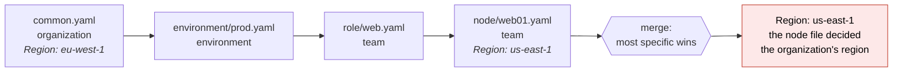
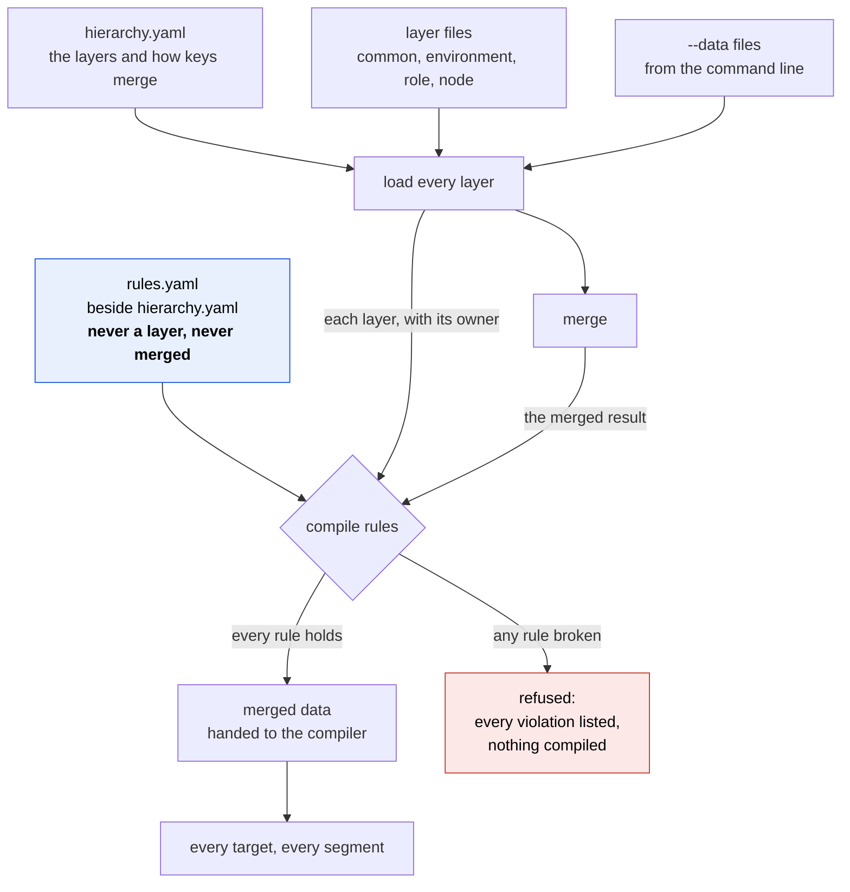
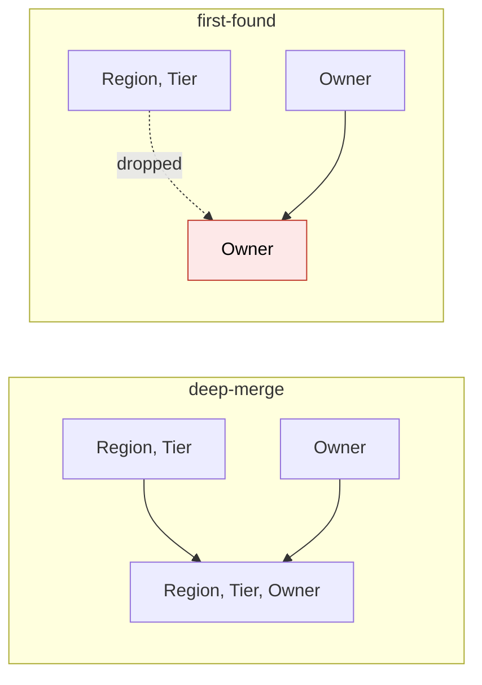

# Compile rules

A hierarchy says **how** layers of configuration merge. Compile rules say what
a layer is **allowed** to do in that merge. They are checked before anything is
compiled, they are the same for every target and every segment, and a
configuration that breaks one is refused with a message that names the rule,
the layer and the key.

The rule this feature started from comes from running
[DscPipelineRunner](https://github.com/ZanattaMichael/Dsc.PipelineRunner)
configurations: **a more specific file cannot overwrite a variable or a secret
that a less specific file set.** An organization's baseline stays the
organization's, whatever a team's node file says.

This page is the design: what the rules are for, where they sit, and why they
are shaped the way they are. The [reference](../reference/compile-rules.md) has
every field and every message.

## The problem

Layered configuration lets many people contribute to one result. An
organization writes a baseline, an environment adjusts it, a team adds its
roles, and a node file adds what is true of one machine. The merge is what
makes this useful, and it is also the risk: by default the most specific layer
wins, so the file with the least review can change anything above it.



A merge strategy cannot fix this, because a strategy is about how values
combine and not about who may set them. That takes a policy.

## What DscPipelineRunner does, and what Meridian takes from it

DscPipelineRunner compiles a [Datum](https://github.com/gaelcolas/Datum) tree
of YAML files into one file per node, and its capability policy says what
each layer of that tree may use. Its ideas about where a policy lives and how
a layer gets an owner carry over directly.

| DscPipelineRunner | Meridian compile rules |
|---|---|
| Layers are listed in `Datum.yml` under `ResolutionPrecedence`, and each file has `parameters`, `variables` and `resources` | Layers are listed in `hierarchy.yaml`. The shipped rule sets protect the keys `variables`, `secrets` and `credentials` |
| `Policy.yml` sits beside `Datum.yml`. It is a file of its own, outside the hierarchy, so **no layer can add to it or override it** | `rules.yaml` sits beside `hierarchy.yaml`. It is never a layer and never merged, and a hierarchy that lists it as a layer is refused |
| A layer is decided by **where a file is**, never by what it says. A file no layer claims may do nothing | Groups claim layers by path pattern. A layer no group claims is refused |
| Every violation is listed, and offending values are not logged | Every violation is listed. A refusal names the rule, layer, group and key, and never a value |
| `-RequirePolicy` fails a run that has no policy, and `-PolicyPath` takes the policy from somewhere contributors cannot write | `--require-rules` and `--rules FILE` |
| `variables` cannot take a name the runner reserves or replace a variable the agent already has; between layers they merge deeply, so the most specific file wins | `use: [protect-variables, protect-secrets]` makes the less specific layer's variables, secrets and credentials hold against every more specific layer |

What Meridian adds is that the policy is **declarative and yours to write**:
six kinds of rule, each over key patterns and layer groups, so the same engine
that keeps a node from changing the organization's region can also require
every team layer to name an owner, or forbid a floating image tag.

## Where the rules sit



Three things follow from this placement.

**The rules see layers, not only the result.** A merged value does not say who
set it. The rules are given every layer as it was loaded, with its owner, so
they can say that `node/web01.yaml` changed something `common.yaml` set.

**The rules run before any target is involved.** The check is over data, and
data is the same whichever tool a document compiles for. There is no Ansible
rule or Terraform rule; a rule holds for all of them or for none.

**The rules file is outside what it constrains.** A policy that a layer could
contribute to is a policy a layer could switch off. So the rules are a file of
their own, found beside the hierarchy file, and a hierarchy path that resolves
to that file (by name, through `..`, or through a symbolic link) is an error.

## Ownership: groups

A rule usually needs to say *whose* values are protected and *who* is
constrained. Groups give layers owners:

```yaml
layers:
  - name: organization
    paths: [common.yaml]
  - name: environment
    paths: ["environment/*"]
  - name: team
    paths: ["role/**", "node/**"]
```

The first group whose pattern matches a layer's path owns it. Ownership is
decided by path because a path is something a contributor cannot choose for
someone else's file: your repository's own controls (CODEOWNERS, branch
protection by folder) are what tie a folder to a team, and the groups mirror
them. Nothing written inside a layer can change its group.

Values given on the command line with `--data` are merged last and win, so
they are checked as the most specific layers, in a group of their own called
`(command line)`. A protected value cannot be changed from the command line
either.

## The rules

| Rule | Says | Typical use |
|---|---|---|
| `no-override` | a more specific layer may not change a value a less specific layer set | the organization's variables and secrets hold |
| `final` | once a layer sets a key, no more specific layer may set it at all, even to the same value | a value decided in exactly one place |
| `restrict` | only the named groups may set a key | only the platform team declares secrets |
| `required` | a key must be set, in every layer of a group or in the merged result | every team layer names an owner |
| `forbidden-value` | a key may not hold certain values | no `:latest` image tags, no plain HTTP |
| `merge-strategy` | a key may only be merged with certain strategies | `variables` must merge deeply |

Three sets ship with Meridian and are switched on by name with `use:`:
`protect-variables`, `protect-secrets` and `protect-all`. They are ordinary
`no-override` rules, and nothing is in force that the rules file does not ask
for.

## Rules follow the merge

Whether a layer has overridden something depends on how the key merges, so the
rules ask the hierarchy. The same two layers are judged differently under
different strategies, and rightly:

```yaml
# common.yaml                      # node/web01.yaml
variables:                         variables:
  Region: eu-west-1                  Owner: web-team
  Tier: gold
```

| Strategy for `variables` | What the merge does | `protect-variables` |
|---|---|---|
| `deep-merge` | the node's `Owner` is added beside `Region` and `Tier` | passes: nothing the organization set has changed |
| `first-found` | the node's `variables` **is** the answer; `Region` and `Tier` are gone | refused: the node dropped two organization variables without naming either |



This is why the engine does not look for a key being *written twice*. It works
out, value by value, what the more specific layer's contribution does to the
less specific layer's: **changed**, **restated**, **dropped**, or untouched. A
`no-override` rule refuses changed and dropped; `final` refuses restated too.
The cases that follow from this are the ones an override attempt would use:

- replacing a mapping with `null`, a string or an empty list, which changes
  everything beneath it without naming any of it;
- setting one key of a mapping that merges by replacement, which drops the
  rest;
- replacing a protected list with a longer one;
- changing only a value's type, such as `5432` to `"5432"`;
- writing the same change in a `--data` file instead of a layer.

Each is refused, and each has a test.

The engine reduces every strategy to one of three kinds: the more specific
value **replaces** the whole, mappings merge **deep**, or lists are
**appended**. That is all a rule needs to know, and it is how the rules stay
correct as the language gains strategies: a new strategy only has to say which
of the three it is.

## What a refusal looks like

```
error: compile rules: 2 violations; nothing was compiled
  - [meridian/protect-variables] layer "node/web01.yaml" (team) changes "variables.Region", which layer "common.yaml" (organization) set
  - [team-layers-name-an-owner] layer "node/web01.yaml" (team) does not set "variables.Owner", which every layer of team must set
```

Every violation is listed, in a fixed order, so one run shows everything there
is to fix and two runs over the same files print the same text. A refusal
never includes a value: the keys a rule guards are the ones most likely to
hold something that must not reach a pipeline log.

## How this fits the rest of the language

**Today.** The rules are evaluated over a `hierarchy.yaml` and its layers by
[`meridian rules check`](../reference/cli.md#rules-check), which a pipeline
runs before `compile`, and by the library call `meridian_rules::enforce`. The
`compile`, `plan` and `apply` commands do not read a hierarchy yet (they take
flat `--data` files), so they do not run the rules by themselves yet.

**With the language expansion.** The proposal in
`docs/plans/language-expansion.md` (pull request 59) moves layers into a
`Data` document, adds merge strategies, and makes `compile` resolve layered
data itself. That work calls `enforce` at the point the layers are loaded, so
from then on a broken rule stops `compile`, `plan` and `apply` directly. The
design was agreed with that proposal:

- its layers stay least specific first, which is the order the rules assume;
- each of its strategies maps onto replace, deep or append;
- its `--data` and `--set` values become the last layers, which the rules
  already check as `(command line)`;
- its `final:` list on a `Data` layer is the language's own way to mark a key
  final, and the `final` rule here is the same check written as policy.

**Declarations.** That proposal also declares variables, secrets and
credentials in documents, where a nearer scope may override a farther one.
The engine is not tied to data files: it checks any ordered stack of layers.
Scopes are such a stack, with keys `variables.<name>`, `secrets.<name>` and
`credentials.<name>`, so `protect-variables` and `protect-secrets` will apply
to declarations unchanged once they exist.

## Limits

- The rules are not a sandbox. They check what layers say, not what a tool
  does with the result.
- The rules file is in the configuration repository unless you keep it
  elsewhere. Whoever can change it decides what every layer may do. Protect
  `rules.yaml` and `hierarchy.yaml` with your most trusted owners, or keep the
  rules where contributors cannot write and pass `--rules`, and use
  `--require-rules` so that deleting the file is an error and not a way out.
- `required` for a group checks the layers that exist. A layer file that is
  missing is not a layer, so pair it with a `required` on the merged result
  when the value must exist one way or another.
- Keys are compared exactly, including case, because that is how data is read.
  `variables.Region` and `variables.region` are two keys, and a rule protects
  the one it names.
