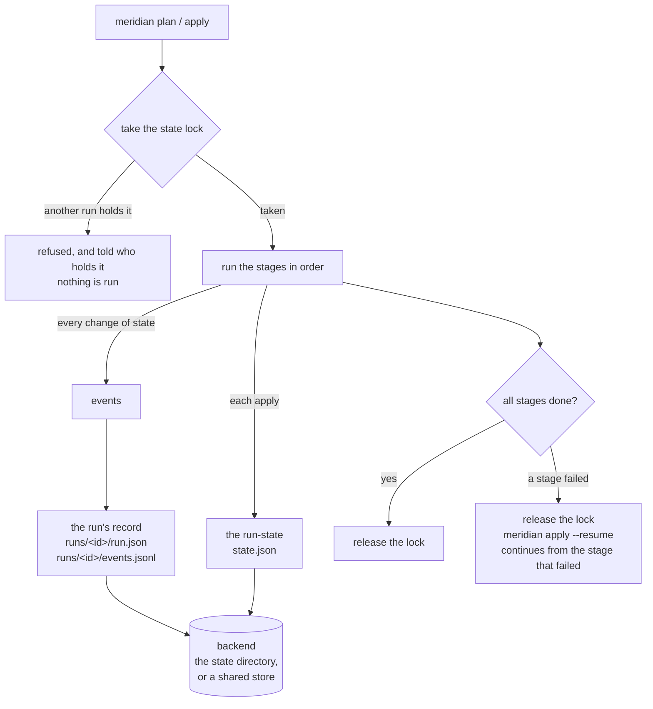
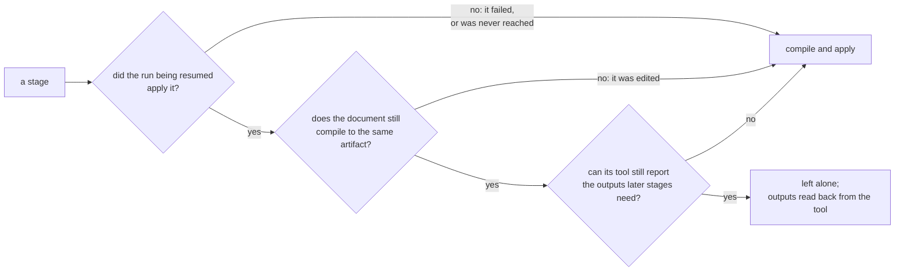
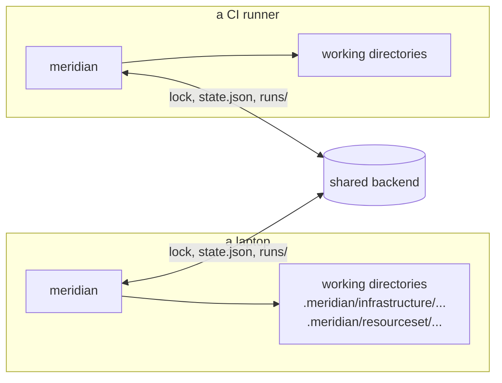

# Running safely

A run that reaches a tool changes real things, takes real time, and can fail
half way. This page says what Meridian does so that a run can be repeated,
shared between people, and picked up where it stopped.



Three rules hold throughout:

- **Each tool owns its own state.** Meridian's record says what Meridian did.
  It is never the truth about your infrastructure, and outputs are never
  stored in it: they are read back from the tool that produced them.
- **Nothing kept holds a secret value.** The record names things: a step, a
  resource id, an output, the hash of an artifact. It never holds a param, an
  output's value, or what a tool printed.
- **`compile` and `validate` are outside all of this.** They contact nothing,
  so they take no lock and leave no record.

## One run at a time

Two runs against the same state collide in ways no tool can untangle: two
`terraform apply`s in one directory, a plan read while an apply is half done.
So `plan` and `apply` first take the state's lock.

```
$ meridian apply site.yaml
error: the state is locked by another run: lock 2026-11-17T09-14-03Z-0cc7, taken by `meridian apply site.yaml` (mike@build-07, process 4242) at 2026-11-17T09:14:03.204Z
Wait for it to finish, or wait here with --lock-timeout. If that run is gone and will never release it, remove the lock with `meridian unlock 2026-11-17T09-14-03Z-0cc7`
```

- `--lock-timeout 5m` waits for the other run instead of giving up at once.
- The lock is released when the run ends, whether it succeeded or failed.
- **Meridian never breaks a lock by itself.** A process on another machine
  cannot be seen to be dead, and guessing wrong is exactly the collision the
  lock exists to prevent. If a run was killed and left its lock, look at who
  holds it with `meridian status`, make sure that run is really gone, and
  remove it with `meridian unlock <id>`. The id has to be given, so the lock
  removed is the one you looked at.

The lock covers one state: one `--state-dir`, or one shared
[backend](#sharing-the-record). Workflows that should not block each other
belong in different states.

## The record

Every run that takes the lock is recorded, under an id that sorts by when it
started, such as `2026-11-17T09-14-03Z-0cc7`.

```
$ meridian status
run 2026-11-17T09-14-03Z-0cc7: apply, failed
  command:  meridian apply site.yaml
  started:  2026-11-17T09:14:03.204Z by mike@build-07
  finished: 2026-11-17T09:15:11.910Z
  network (Infrastructure, target terraform): succeeded, 4 changes
  web (ResourceSet, target ansible on 203.0.113.10): failed (tool-failed), 2 changes
not locked
```

| Command | Shows |
|---|---|
| `meridian status` | the current or last run, step by step, and who holds the lock |
| `meridian runs` | every recorded run, oldest first, with its mode and how it ended |
| `meridian events [run]` | the run's events, one JSON object per line; `--type step.failed` or `--type 'step.*'` narrows them |
| `--events json` on `plan` or `apply` | the same events on standard output while the run is going, for CI |

A run that was killed never says how it ended. `status` shows it as
`interrupted`, with the last step it had started.

A failed step is recorded with a fixed word for the kind of failure
(`tool-failed`, `plugin-failed`, `compile-refused` and so on), never with what
the tool said. A tool can quote a value in an error message, and the record
is not the place to find that out. What the tool said is on the terminal of
the run that failed.

The newest 50 runs are kept; `--keep-runs N` changes that. Every file and
field is in [the state reference](../reference/state.md).

## Picking up where a run stopped

A run stops at the first stage that fails, and the stages after it are not
attempted. Once the cause is fixed, there is no need to start from the top:

```
$ meridian apply site.yaml --resume
network (Infrastructure, target terraform)
  already applied by run 2026-11-17T09-14-03Z-0cc7, and unchanged since; left alone
web (ResourceSet, target ansible on 203.0.113.10)
  ~ update nginx_conf
  applied 1 change
```



- `--resume` continues the last apply; `--resume <run>` names one.
- "The same" means the same compiled artifact, by its hash. A document you
  edited is applied again. One you did not touch is not.
- A stage that is left alone still hands on its outputs. They are read from
  its tool, exactly as a `plan` of existing infrastructure reads them.
- If the tool cannot report them, the stage is applied again. An apply is
  safe to repeat; a guessed address is not.
- A run that was killed can be resumed in the same way, after its lock has
  been removed with `meridian unlock`.
- Resuming a run that succeeded is refused: there is nothing to continue.

Resuming is a saving, not a different result. A plain `meridian apply` of
the same documents reaches the same end, by asking every tool again.

## Sharing the record

By default the record is in the state directory, which suits one person or
one CI job. A team wants one lock and one history, wherever a run happens:

```
meridian apply site.yaml --backend dir --backend-config path=/mnt/team/meridian
```



`local` is built in. Any other backend is a small program named
`meridian-backend-<name>` in a plugin directory, and can be a shell script
around a cloud CLI. One that keeps the record in a shared directory ships in
[`examples/backends`](../../examples/backends), and
[the state reference](../reference/state.md#writing-a-backend) has the whole
contract.

**What a backend does not hold.** Each tool's working directory stays on the
machine that runs Meridian. A tool's own state belongs in that tool's own
remote backend (a Terraform `backend` block, a Pulumi backend), set in the
document. A shared Meridian backend gives a team one lock, one history, and
one answer to "what was applied last, and did it work".

## What this does not do yet

Rollback, drift detection and policy checks before an apply are designed in
[the run safety plan](../plans/run-safety.md) and arrive in the pull requests
that follow this one.
