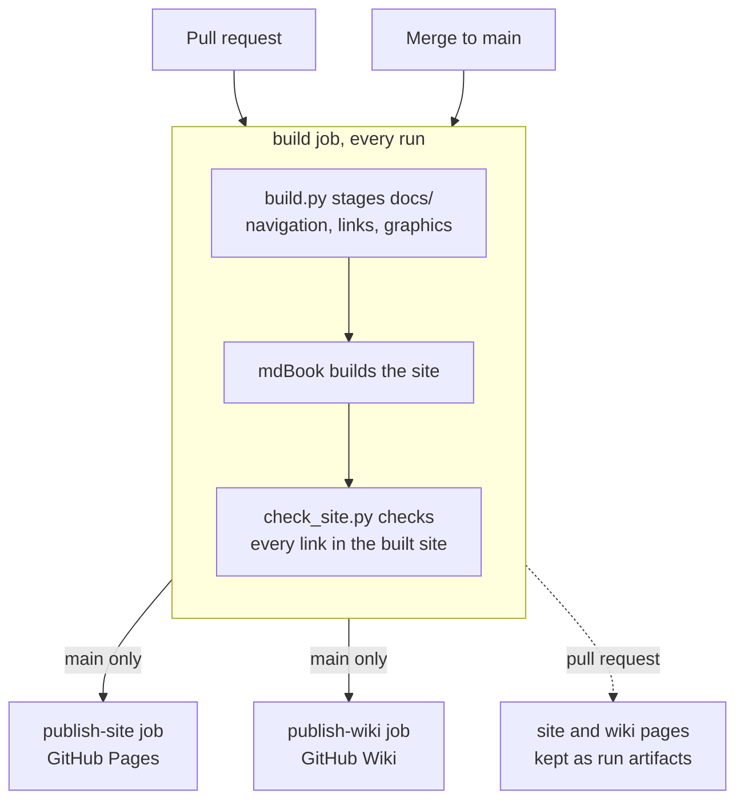

# How the wiki is published

Everything under `docs/` is published twice by one pipeline, and nothing is published
by hand:

| Where | Address | What it is |
|---|---|---|
| The documentation site | <https://zanattamichael.github.io/meridian-core/> | An [mdBook](https://rust-lang.github.io/mdBook/) site on GitHub Pages: sidebar navigation, full-text search, light and dark themes, rendered diagrams |
| The GitHub Wiki | <https://github.com/ZanattaMichael/meridian-core/wiki> | The same pages in the repository's Wiki tab, with a generated sidebar |

`docs/` is the only source. To change a page, change its file under `docs/` in a pull
request. The published copies are rebuilt from `main` every time a pull request merges,
so they cannot fall behind it. An edit made in the Wiki tab is overwritten by the next
run.

## What you have to do when you add documentation

Add the Markdown file under `docs/`. That is all.

- **Navigation.** There is no table of contents to edit. The pipeline reads the
  directory tree, and each page's first `#` heading becomes its name in the sidebar.
- **Targets.** A page at `docs/targets/<name>.md` is listed under the category its
  plugin declares, which the pipeline reads from the generated
  [capability matrix](../reference/capability-matrix.md).
- **Logos.** If `docs/branding/logos/meridian-<name>.svg` exists, it is shown at the top
  of that target's published page and in the plugin map on the home page. The logo
  family is described in [Meridian branding](../branding/README.md).
- **Links.** Write ordinary relative links, as they work on GitHub. A link to a file
  outside `docs/`, such as an example under `examples/`, is published as a link to that
  file on GitHub.
- **Diagrams.** Write a fenced `mermaid` block. GitHub, the Wiki and the site all draw
  it. The diagram below is one.

## The pipeline

The workflow is [`.github/workflows/wiki.yml`](../../.github/workflows/wiki.yml).



| Job | Runs on | What it does |
|---|---|---|
| `build` | every pull request, every push to `main`, weekly, and on demand | Stages `docs/`, builds the site, checks every internal link, image and heading anchor in the built pages, and keeps the site and the wiki pages as artifacts of the run |
| `publish-site` | `main` | Deploys the built site to GitHub Pages |
| `publish-wiki` | `main` | Replaces the contents of the Wiki with the generated pages |

A pull request never publishes anything. It proves that the site still builds and that
no link in it is broken, and its run keeps the built site as an artifact named
`github-pages`, which can be downloaded and opened to preview the change.

### Link checks

There are three, and they look at different things:

| Check | Workflow | Looks at | Blocks a pull request |
|---|---|---|---|
| `tools/check_links.py` | `docs` | Relative links and heading anchors in every Markdown file in the repository | Yes |
| `tools/wiki/check_site.py` | `wiki` | Every link, image, stylesheet, script and `#fragment` in the HTML that mdBook wrote | Yes |
| [lychee](https://lychee.cli.rs/) | `wiki`, weekly and on demand | Links to other websites | No |

Links to other websites are fetched once a week rather than on every pull request, so
that somebody else's server being down cannot stop a merge.

## How the pages are generated

[`tools/wiki/build.py`](../../tools/wiki/build.py) writes both forms into `target/wiki/`
(which git ignores) using only the Python standard library.

| It does this | For the site | For the Wiki |
|---|---|---|
| Builds the navigation from the directory tree | `SUMMARY.md`, mdBook's table of contents | `_Sidebar.md` |
| Names each page | Keeps the path; a directory's `README.md` is served as its `index.html` | Flattens the path: `docs/targets/ansible.md` is the page `Targets-Ansible`, `docs/index.md` is `Home` |
| Rewrites links between pages | Relative links, unchanged | Links to the flattened page names |
| Rewrites links that leave `docs/` | Links to the file on GitHub | The same |
| Draws the plugin map | `generated/meridian-plugin-map.svg` | The same file |
| Adds the graphics to pages | The plugin map on the home page, each target's logo on its page | The same |

Sections appear in a fixed reading order (quickstart, concepts, reference, targets, and
so on, with the planning documents and branding last). A new top-level directory is
placed before the planning documents automatically. The order, and the title each
directory is shown under, are the short tables at the top of `build.py`.

### The graphics

The home page carries two graphics:

- **The banner** is a pair of files kept in
  [`docs/branding/banner/`](../branding/README.md#banner), one for light and one for dark
  colour schemes. `docs/index.md` and the repository README both show it, so it is the
  same on GitHub, the site and the Wiki.
- **The plugin map** is drawn by `build.py` each time, not kept as a file, so it is never
  out of date. It shows one document going through the core to every plugin, in a
  column for each category. Its columns and its plugins come from the capability
  matrix and `docs/targets/`, and each tile uses the plugin's own logo. A plugin that
  has no logo yet gets a lettered tile.

The site's look is [`tools/wiki/theme/meridian.css`](../../tools/wiki/theme/meridian.css)
on top of mdBook's stock themes, and its settings are
[`tools/wiki/book.toml`](../../tools/wiki/book.toml).

## Building it on your own machine

You need Python 3.10 or later, and for the site, mdBook and its diagram plugin at the
versions the workflow pins:

```
cargo install --locked mdbook --version 0.5.4
cargo install --locked mdbook-mermaid --version 0.17.1
```

Then, from the top of the repository:

```
python3 tools/wiki/build.py all                # stage both forms into target/wiki/
mdbook-mermaid install target/wiki/site        # add the diagram scripts
mdbook build target/wiki/site                  # write target/wiki/site/book/
python3 tools/wiki/check_site.py target/wiki/site/book --site-url=/meridian-core/
```

`mdbook serve target/wiki/site --open` shows the site in a browser. The Wiki pages are
plain Markdown in `target/wiki/wiki/`.

## Repository settings the pipeline depends on

Two settings can only be changed by an owner of the repository. Until each is set, its
publish job prints a warning that says what is missing and finishes without failing;
the build and the link checks run regardless.

| For | Setting |
|---|---|
| The site | **Settings → Pages → Build and deployment → Source: GitHub Actions** |
| The Wiki | **Settings → General → Features → Wikis** ticked, and then one page created by hand in the Wiki tab (any content; it is replaced). GitHub does not create a wiki's storage until it has a first page, and a workflow cannot create it |

It is also worth ticking **Restrict editing to collaborators only** under the Wikis
feature, since anything typed into the Wiki is replaced on the next run.

## Changing the address

The site's address appears in `tools/wiki/book.toml` (`site-url`,
`git-repository-url`, `edit-url-template`), in the `--site-url` argument in the
workflow, and in the table at the top of this page. The Wiki's addresses follow the
repository's name automatically.
