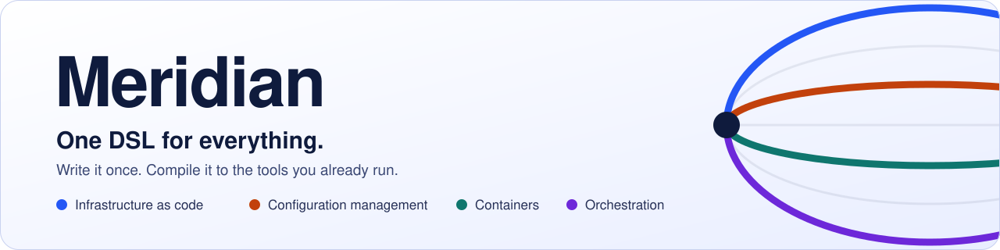

# Meridian

<picture>
  <source media="(prefers-color-scheme: dark)" srcset="branding/banner/meridian-banner-dark.svg">
  
</picture>

Meridian is one declarative language that compiles to Ansible, Puppet, Chef, DSC,
cloud-init, Terraform, CloudFormation, Bicep, ARM templates, Pulumi, Docker Compose, Kubernetes and Helm, and then drives
the tool you chose to plan and apply it.

## Honest scope statement

Meridian is a **transpiler and orchestrator**, not a replacement execution engine. It
does not reimplement Ansible's SSH orchestration, Terraform's state graph, or Puppet's
catalog model — it compiles a single declarative intent into the native artifact each of
those tools already knows how to run.

The consequence, stated up front rather than discovered later: these tools differ in
execution model, state tracking, dependency expression, and idempotency guarantees.
Meridian abstracts intent, not those differences. Where a feature has no clean mapping
on a target, Meridian emits a documented workaround or fails at compile time. It never
degrades silently. See [the capability model](plans/design-plan.md#8-the-notifies-property--capability-matrix).

## Project status

Early implementation. The core, the plugin protocol and the plugins are written in Rust.
The first implementation was in Go; the core language was changed to Rust on 2026-11-17
and the Go code was removed once the Rust core and plugins reproduced its output byte for
byte. The reasons, the layout and the order of work are in
[design plan §11](plans/design-plan.md#11-system-architecture-rust) and
[§12.1](plans/design-plan.md#121-rust-migration-sequencing).

## User documentation

| Start here | |
|---|---|
| [Install](quickstart/install.md) | build Meridian, and what each target needs |
| [Your first ResourceSet](quickstart/first-resourceset.md) | one document, from validate to apply, and the same document on another tool |
| [A two-stage workflow](quickstart/first-two-stage.md) | one tool creates a machine, another configures it |
| [Worked workflows](quickstart/workflows.md) | six workflows across every target: three tiers on four tools, a cluster platform, a golden image, Windows on Azure, an edge site, and one file for every environment |

| Concepts | |
|---|---|
| [Documents, resources and targets](concepts/ir-overview.md) | the two kinds of document, and the two families of resource types |
| [Dependencies and notifications](concepts/dependencies.md) | `dependsOn` and `notifies`, and what each tool makes of them |
| [The capability model](concepts/capability-model.md) | why a document either does what it says or does not compile |
| [The two-stage architecture](concepts/two-stage-architecture.md) | Infrastructure, ResourceSet and the hand-off between them |

| Reference | |
|---|---|
| [The `meridian` command](reference/cli.md) | commands, options, exit status |
| [The Meridian language](reference/dsl/index.md) | every field of a document, what it must hold, and which check happens when |
| [How it fits together](reference/dsl/how-it-fits-together.md) | a document's path from file to running tool, with diagrams and a worked example |
| The language item by item | [resources](reference/dsl/resources.md), [`dependsOn`](reference/dsl/dependson.md), [`notifies`](reference/dsl/notifies.md), [conditions](reference/dsl/conditions.md), [references](reference/dsl/references.md), [outputs and hand-offs](reference/dsl/outputs-and-hand-offs.md) |
| The language by segment | how `type`, `state`, `params`, references and notifies are written for [configuration management](reference/dsl/configuration-management.md), [infrastructure as code](reference/dsl/infrastructure-as-code.md), [containerization](reference/dsl/containerization.md) and [container orchestration](reference/dsl/container-orchestration.md) |
| [Configuration management resource types](reference/resource-types.md) | `package`, `file`, `service`, `user`, `group`, `exec`, and how each target differs |
| [Capability matrix](reference/capability-matrix.md) | generated from the plugins |
| [Conformance matrix](reference/conformance-matrix.md) | the same document on every configuration management target, cell by cell; generated from the plugins |
| [Compatibility](reference/compatibility.md) | which language versions a build reads, and which plugins it loads; generated from the code |

| Targets | |
|---|---|
| Configuration management | [ansible](targets/ansible.md), [puppet](targets/puppet.md), [openvox](targets/openvox.md), [chef](targets/chef.md), [dsc](targets/dsc.md), [salt](targets/salt.md), [cloud-init](targets/cloud-init.md) |
| Infrastructure as code | [terraform](targets/terraform.md), [opentofu](targets/opentofu.md), [cloudformation](targets/cloudformation.md), [bicep](targets/bicep.md), [arm](targets/arm.md), [pulumi](targets/pulumi.md), [packer](targets/packer.md) |
| Containers | [docker](targets/docker.md), [podman](targets/podman.md), [kubernetes](targets/kubernetes.md), [helm](targets/helm.md) (with Kustomize) |

Every target page opens with what the target does and does not support. Every example the
pages show is a file under [`examples/`](../examples) that a test compiles with the real
plugins.

## Planning documents

| Document | What it settles |
|---|---|
| [Design plan](plans/design-plan.md) | IR schema, pipeline stages, plugin SDK, architecture, build milestones |
| [Testing plan](plans/testing-plan.md) | The five test tiers, the shared fixture library, CI wiring |
| [Documentation plan](plans/documentation-plan.md) | Doc set structure, audiences, generated capability matrix |
| [Governance & contribution model](plans/governance.md) | Plugin tiers, ownership, capability disputes, triage |
| [Migration & adoption path](plans/migration-and-adoption.md) | Forward-compile scope decision, coexistence, pilot guidance |
| [Observability, logging & diagnostics](plans/observability.md) | Log schema, plan output, fact provenance, telemetry, audit |
| [Release, versioning & compatibility](plans/release-and-versioning.md) | apiVersion, SDK compatibility, run-state migration, channels |
| [Modules and versioning](plans/modules-and-versioning.md) | Proposed: shareable modules (sources, lockfile, integrity), how `apiVersion` is enforced, protocol negotiation |
| [Security & secrets handling](plans/security.md) | Threat model, `secret: true` guarantees, disclosure process |
| [Language expansion](plans/language-expansion.md) (accepted, being built) | Expressions and functions, conditions, templating, configurations with inputs, endpoints and inventory, secrets, workflows |

## Contributing

| | |
|---|---|
| [`CONTRIBUTING.md`](../CONTRIBUTING.md) | from a fresh clone to a merged pull request: set up, the checks, review, and the changes that need a second reviewer |
| [Writing a plugin](contributing/writing-a-plugin.md) | add a tool to Meridian, step by step, starting from a template that already works |
| [How Meridian is tested](contributing/testing.md) | unit tests and golden files, property tests, cross-target conformance, examples, coverage; and how to add to each |
| [Code of Conduct](../CODE_OF_CONDUCT.md) | how we treat each other |

Security reports go through [`SECURITY.md`](../SECURITY.md), not the issue tracker.

These pages are published as a site and as the repository's wiki by a pipeline;
[how the wiki is published](contributing/documentation-site.md) describes it and what a
new page needs.

## Reading order

New to the project: start with the design plan's problem statement and guiding
principles (§1–§2), then the IR schema overview (§4). Everything else is downstream of
those.
