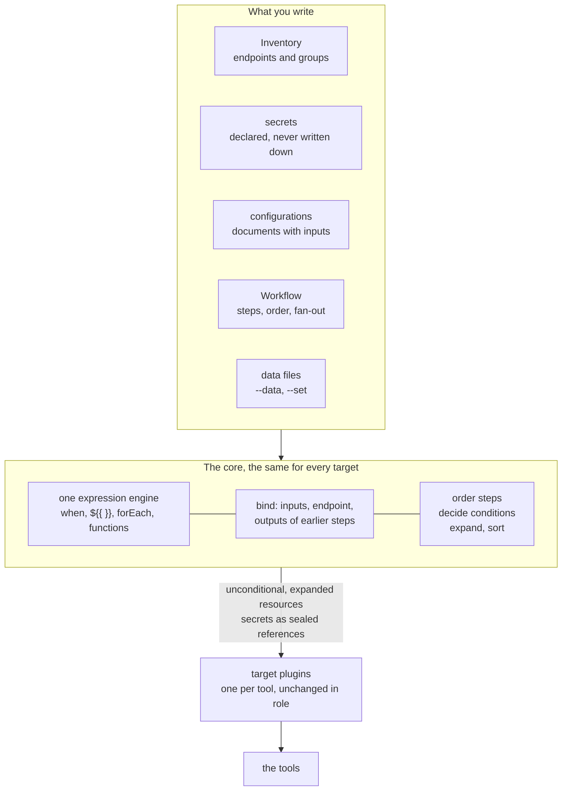
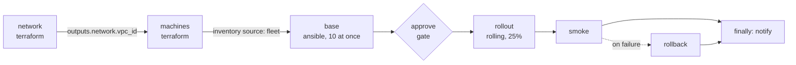

# Language expansion: expressions, configurations, endpoints, secrets and workflows

**Status: proposed.** This plan is a design for review. Nothing in it is
implemented yet; the [language reference](../reference/dsl/index.md) stays the
description of what the `meridian` command accepts today. Each numbered phase in
[section 12](#12-delivery-in-phases) lands as its own pull request and moves its
part of this plan into the reference.

The choices marked **Decision** are the ones the rest of the design hangs on.
They are collected in [section 11](#11-decisions-for-the-owner).

## Contents

1. [What this changes, in one picture](#1-what-this-changes-in-one-picture)
2. [One expression language](#2-one-expression-language)
3. [Conditions](#3-conditions)
4. [Interpolation and templating](#4-interpolation-and-templating)
5. [Common properties: one document shape](#5-common-properties-one-document-shape)
6. [Configurations: documents with inputs](#6-configurations-documents-with-inputs)
7. [Targets and endpoints](#7-targets-and-endpoints)
8. [Secrets](#8-secrets)
9. [Workflows](#9-workflows)
10. [Compatibility](#10-compatibility)
11. [Decisions for the owner](#11-decisions-for-the-owner)
12. [Delivery in phases](#12-delivery-in-phases)
13. [Test plan](#13-test-plan)

## 1. What this changes, in one picture

Today the language has two kinds of document, one small condition language that
reads `--data` files, references that each plugin rewrites, and one tie between
documents (an output becomes a `targetHost`). This plan adds five things and
keeps one rule.

The rule: **everything in this plan is decided by the core, before a plugin
sees the document.** A plugin still receives resources that are unconditional,
fully expanded and in order. So a condition, a function or an interpolation
cannot mean one thing on Ansible and another on Terraform, because neither tool
ever sees it.



| Area | Today | Proposed |
|---|---|---|
| Conditions | `when` on a resource: `==`, `!=`, `!`, `&&`, `\|\|`, `defined()` over `data.*` | the full expression language, on resources, documents, outputs, workflow steps and endpoints; named conditions defined once and reused |
| Templating | none in the core; `${id.param}` settled per plugin | `${{ expression }}` in any value of a document, `forEach`, file templates, a function library |
| Document shape | `Infrastructure` and `ResourceSet` have different fields | one shared `spec`; the kind only says which segments take it |
| Reuse | none | a document declares `inputs` and is instantiated with values |
| Where it runs | `targetHost`, one host, ResourceSet only | `endpoints` for every segment, from an `Inventory` document |
| Secrets | none (planned in [security](security.md)) | declared with a provider, read as `secret.<name>`, never printed or stored |
| Workflows | every Infrastructure document, then every ResourceSet | a `Workflow` document: steps, dependencies, fan-out, gates, failure handling |

## 2. One expression language

There is one expression language. `when`, `${{ }}`, `forEach`, an input's
default and a workflow step's condition are all the same grammar, evaluated by
the same code (a new crate, `meridian-expr`), with the same errors. The
condition language of today is a strict subset of it, so every `when` written
today keeps its meaning.

### 2.1 Values

| Type | Written | Notes |
|---|---|---|
| null | `null` | |
| boolean | `true`, `false` | |
| number | `3`, `-1`, `1.5` | integers and floats; `3 == 3.0` |
| text | `'prod'`, `"prod"` | `\'`, `\"`, `\\`, `\n`, `\t` escapes |
| list | `[1, 2, 3]` | |
| mapping | `{name: 'web', port: 80}` | keys are text |

A value can also be **secret** ([section 8](#8-secrets)) or **not known yet**
(an output of a step that has not run, [section 9](#9-workflows)). Both are
properties of a value, not types, and both spread to anything computed from it.

### 2.2 Names an expression can read

| Name | Holds | Known |
|---|---|---|
| `data.<key>` | the values of the `--data` files and `--set` | always |
| `inputs.<name>` | the values this instance of a configuration was given | always |
| `local.<name>` | a named expression of the document (`spec.locals`) | always |
| `cond.<name>` | a named condition (`spec.conditions`), true or false | always |
| `each.key`, `each.value`, `each.index` | the current item, inside `forEach` | always |
| `endpoint.name`, `.type`, `.address`, `.labels`, `.groups`, `.vars` | the endpoint this instance runs on | always |
| `meridian.document`, `.kind`, `.target`, `.workflow`, `.step`, `.mode` | about the run itself; `mode` is `compile`, `plan` or `apply` | always |
| `secret.<name>` | a declared secret | at plan and apply; a sealed reference at compile |
| `outputs.<document>.<name>` | an output of another document | after that document is applied |
| `steps.<step>.outputs.<name>`, `steps.<step>.status` | the same, by workflow step | after the step |
| `facts.<path>` | facts gathered from the endpoint | see [3.4](#34-conditions-that-depend-on-the-machine) |
| `<id>.<param>` | a param of another resource in the same document | always |

A name the run does not set is an error, never an empty value:
`data.env is not set (give it with --data or --set, or test for it with
defined(data.env))`.

### 2.3 Operators

From loosest to tightest:

| Operators | Meaning |
|---|---|
| `c ? a : b` | choice; only the chosen side is evaluated |
| `a ?? b` | `a`, or `b` when `a` is null or not set |
| `\|\|` | or; the right side is read only when the left leaves the answer open |
| `&&` | and; likewise |
| `==`, `!=` | the same value, of the same type (numbers compare by value) |
| `<`, `<=`, `>`, `>=` | numbers with numbers, text with text. Anything else is an error, not `false` |
| `in`, `not in` | an element of a list, a key of a mapping, or text inside text |
| `=~`, `!~` | text matches a regular expression |
| `+`, `-` | numbers; `+` also joins text with text and list with list |
| `*`, `/`, `%` | numbers. Division by zero is an error |
| `!`, unary `-` | not, negative |
| `a.b`, `a[0]`, `a['k']`, `f(x)` | field, index, key, call |

Rules:

- There is no silent conversion. `'3' == 3` is false, `'3' + 3` is an error
  that names both types. Convert on purpose: `toNumber('3')`.
- `&&`, `||` and `!` take booleans only. Text or a number is not a yes or a no.
- A condition must come out `true` or `false`.
- Evaluation always ends: there are no loops, no recursion and no user code.
- Evaluation is pure. The same document and the same data always give the same
  result. The only windows to the outside are named and visible: `env()`,
  `file()`, `template()`, secrets and facts.

### 2.4 Functions

One built-in library, the same for every target and every place an expression
can be written.

| Group | Functions |
|---|---|
| Presence | `defined(x)`, `coalesce(a, b, ...)`, `default(x, fallback)`, `required(x, 'message')` |
| Text | `lower`, `upper`, `title`, `trim`, `trimPrefix`, `trimSuffix`, `replace`, `split`, `join`, `format`, `startsWith`, `endsWith`, `contains`, `substr`, `indent`, `quote`, `regexMatch`, `regexReplace`, `regexFind` |
| Numbers | `min`, `max`, `abs`, `floor`, `ceil`, `round`, `sum` |
| Lists and mappings | `length`, `keys`, `values`, `entries`, `merge`, `deepMerge`, `concat`, `flatten`, `unique`, `sort`, `reverse`, `first`, `last`, `slice`, `range`, `zip`, `lookup(map, key, fallback)`, `pick`, `omit`, `any`, `all` |
| Selection | `where(list, 'field', value)`, `pluck(list, 'field')`, `groupBy(list, 'field')` |
| Types | `type(x)`, `toString`, `toNumber`, `toBool`, `toJson`, `fromJson`, `toYaml`, `fromYaml` |
| Encoding | `base64Encode`, `base64Decode`, `urlEncode`, `sha256`, `sha1`, `md5` |
| Network | `cidrHost`, `cidrSubnet`, `cidrNetmask`, `cidrContains` |
| Versions | `semverCompare(a, b)`, `semverSatisfies(v, '>=1.2 <2')` |
| Files | `file('path')`, `fileExists('path')`, `template('path', {vars})`, `basename`, `dirname`, `joinPath` |
| Environment | `env('NAME')`, `env('NAME', fallback)` |
| Conditions | `matchesSelector(labels, 'tier=web,env!=dev')` |

Paths given to `file` and `template` are relative to the document that names
them and may not leave the directory tree of the files given to the command.

A project can also define its own functions, as named expressions with
arguments. They are expressions, not code, so they stay pure and always end:

```yaml
spec:
  functions:
    fqdn:
      args: [host]
      result: "format('%s.%s.example.com', host, data.env)"
  resources:
    - id: hosts_entry
      type: file
      params:
        path: /etc/hostname
        content: ${{ fqdn(endpoint.name) }}
```

A user function cannot call itself, directly or through another.

## 3. Conditions

**Decision A.** Every condition in the language is a Meridian expression,
decided by the core. No target evaluates, translates or even receives one.
That is what makes conditions the same across targets: there is only one place
they are decided.

### 3.1 Where a condition can be written

| Place | Effect when false |
|---|---|
| a resource: `when` | the resource is not in the compiled output (as today) |
| a document: `spec.when` | the document is not a stage of this run; reported as `skipped: its when is false` |
| an output: `when` | the output is not declared |
| a `dependsOn` or `notifies` entry: `when` | the entry is dropped |
| a workflow step: `when` | the step is skipped; steps that depend on it follow their `ifSkipped` |
| an inventory endpoint or group member: `when` | the endpoint is not part of the inventory for this run |

`ifMissing` keeps its meaning and applies wherever a condition can remove the
other end of something.

### 3.2 Named conditions

A condition used more than once is defined once and read as `cond.<name>`:

```yaml
spec:
  conditions:
    is_prod: "data.env == 'prod'"
    is_debian: "endpoint.labels.os == 'debian'"
    needs_tls: "cond.is_prod || data.force_tls ?? false"
  resources:
    - id: cert
      type: file
      when: cond.needs_tls
      params: {path: /etc/ssl/site.pem, content: "${{ secret.site_cert }}"}
    - id: apt_cache
      type: exec
      when: cond.is_debian && !cond.is_prod
      params: {command: apt-get update}
```

Conditions shared by several documents live in a `Definitions` document
([section 6.3](#63-shared-definitions)), so a whole workflow agrees on what
"production" means.

### 3.3 What a condition does to a plan

`plan` and `compile` report every decision, so a removed resource is never a
surprise:

```
site (ResourceSet, target ansible, endpoint web01)
  when: 2 resources removed
    cert         cond.needs_tls is false
    debug_log    data.env != 'prod' is false
```

A condition that reads a secret reports the resource and the answer and never
the operand ([security plan section 2](security.md#2-what-secret-true-guarantees-per-stage)).

### 3.4 Conditions that depend on the machine

Today `runtimeWhen` is the only way to decide on something the machine knows,
and it is written in each tool's own language, so it is the one condition that
is *not* the same across targets.

**Decision B.** Machine-dependent conditions become ordinary `when`
expressions over `facts.*`, gathered by Meridian from the endpoint before the
document is compiled. This is the design the
[design plan, section 6](design-plan.md#6-condition--fact-gathering-pipeline)
already chose.

```yaml
- id: apt_cache
  type: exec
  when: "facts.os.family == 'debian' && !facts.files['/var/lib/apt/periodic/update-success-stamp'].exists"
  params: {command: apt-get update}
```

- A small, fixed set of facts with the same names on every system:
  `facts.os.family`, `.name`, `.version`, `.arch`, `facts.kernel`,
  `facts.hostname`, `facts.fqdn`, `facts.memory.totalMb`, `facts.cpu.count`,
  `facts.network.addresses`, `facts.packages['name'].version`,
  `facts.services['name'].state`, `facts.files['path'].exists`.
- Facts are gathered over the endpoint's own connection
  ([section 7](#7-targets-and-endpoints)), only for a document that reads them,
  and only the groups it reads.
- A document whose endpoint does not exist yet is deferred until it does, the
  same way a document waiting on an output is deferred today.
- Facts are shown with `meridian facts <endpoint>` and recorded with the plan,
  so a reviewer can see what a decision was based on.
- `runtimeWhen` stays as a clearly labelled escape hatch for the narrow case
  that must be checked at the instant of apply. It is documented as the tool's
  own language and as not portable, and `meridian validate --portable` refuses
  it.

## 4. Interpolation and templating

### 4.1 `${{ expression }}`

**Decision C.** An expression is written inside a value as `${{ ... }}`.

```yaml
spec:
  target: terraform
  locals:
    name: "${{ data.project }}-${{ data.env }}"
  resources:
    - id: web
      type: aws_instance
      params:
        instance_type: "${{ cond.is_prod ? 'm5.large' : 't3.micro' }}"
        count: ${{ data.replicas ?? 1 }}
        tags:
          Name: ${{ local.name }}
          Owner: ${{ upper(data.team) }}
```

Why this spelling: `${id.path}` already means "a reference the tool resolves",
and several tools own `{{ }}` (Ansible, Helm, Salt, Packer) and `%{ }`
(Terraform, Hiera) in text Meridian must pass through untouched. `${{ }}`
collides with none of them and reads as "the same idea, decided earlier".

| You write | You get |
|---|---|
| a value that is only `${{ expr }}` | the expression's value with its type: a number stays a number, a list stays a list |
| `${{ expr }}` inside longer text | the value placed in the text. It must be text, a number or a boolean; a list or mapping is an error (use `join` or `toJson`) |
| `$${{` | a literal `${{`, following the existing `$${` rule |
| `${id.path}` | unchanged: a reference, rewritten by the plugin and resolved by the tool |

The two forms sit side by side, and the difference is *when* the value exists:

| | `${{ ... }}` | `${id.path}` |
|---|---|---|
| Decided by | Meridian's core | the tool, through the plugin |
| Decided when | before compiling | while the tool plans or applies |
| Reads | data, inputs, locals, endpoint, secrets, outputs of earlier steps | attributes of resources the tool creates in this run |
| Same on every target | yes | no: it is the tool's own value |

### 4.2 Where interpolation is allowed

| Place | Allowed |
|---|---|
| any value inside `params`, however deep | yes |
| `state`, `targetVersion`, an output's `value`, `spec.locals`, an input's `default` | yes |
| `metadata.labels` values, `spec.settings`, `spec.endpoints` | yes |
| `spec.target` | yes, from `data`, `inputs` and `local` only (the plugin must be known before anything else is) |
| the top level of a `Workflow`, `Inventory` or `Definitions` document: step `with`, endpoint `address`, `connection`, `vars` | yes |
| `id` | only inside a `forEach`, and it must use `each` |
| `apiVersion`, `kind`, `metadata.name`, `type`, the names in `dependsOn` and `notifies`, mapping keys | no. These are the document's skeleton; `validate` must be able to check them without any data |
| `runtimeWhen` | no. It is passed through untouched |

`when`, `forEach` and `conditions` are already expressions, so they are written
bare, without `${{ }}`. Writing the braces there is accepted and means the same.

### 4.3 `locals`

Named values computed once per document instance, in any order (a local may
read another; a cycle is an error naming the locals in it):

```yaml
spec:
  locals:
    site_root: "/srv/${{ inputs.site }}"
    ports: "${{ cond.is_prod ? [80, 443] : [8080] }}"
```

### 4.4 `forEach`

A resource, an output, a workflow step or a whole `resources` block can be
repeated over a list or a mapping:

```yaml
resources:
  - id: vhost_${{ each.key }}
    forEach: data.sites               # a mapping: name -> settings
    type: file
    params:
      path: /etc/nginx/sites-enabled/${{ each.key }}.conf
      content: ${{ template('vhost.conf.tmpl', {name: each.key, site: each.value}) }}
    notifies:
      - resource: nginx_svc
        action: reload
```

- Over a mapping, `each.key` and `each.value`; over a list, `each.value` and
  `each.index`, and `each.key` is the index as text.
- The `id` must differ for every item, so it must use `each`. Ids that collide
  after expansion are an error naming both items.
- `dependsOn: [{resource: vhost_*}]` is not a pattern language. To depend on
  every instance, name the template: `resource: vhost`, `all: true`.
- An empty collection expands to nothing, and follows `ifMissing` for anything
  that named it.
- `forEach` over a secret, or over a value not known yet, is an error: the
  shape of a document cannot depend on something that cannot be shown.

### 4.5 File templates

`template('path', vars)` renders a file with the same expression language, plus
blocks for loops and choices. Inside a template only `vars` and the names of
[section 2.2](#22-names-an-expression-can-read) are visible.

```
# vhost.conf.tmpl
server {
    server_name ${{ name }};
${{ for port in site.ports }}
    listen ${{ port }};
${{ end }}
${{ if site.tls }}
    ssl_certificate /etc/ssl/${{ name }}.pem;
${{ else }}
    # plain http
${{ end }}
}
```

A line that holds only a block tag leaves no blank line behind. Everything else
in the file, including the tool's own `{{ }}` and `%{ }`, is passed through
untouched.

### 4.6 Order of evaluation

```mermaid
flowchart LR
    A["1. data, --set"] --> B["2. inputs bound<br/>(with, defaults)"]
    B --> C["3. endpoint bound<br/>(one instance per endpoint)"]
    C --> D["4. locals, conditions"]
    D --> E["5. spec.when<br/>document kept or skipped"]
    E --> F["6. forEach expanded"]
    F --> G["7. when on resources<br/>ifMissing applied"]
    G --> H["8. every ${{ }} placed"]
    H --> I["9. sort by dependsOn"]
    I --> J["10. plugin compiles<br/>${id.path} rewritten"]
```



Steps 1 to 9 are the core and identical for every target. Step 10 is the only
one a plugin takes part in.

## 5. Common properties: one document shape

**Decision D.** `Infrastructure` and `ResourceSet` take the same `spec`. The
kind stops deciding which fields exist and only says which segments accept the
document, as it does today. Every existing document stays valid.

### 5.1 The shared `spec`

| Field | Today | Proposed for every document |
|---|---|---|
| `target` | both | unchanged |
| `targetVersion` | both | unchanged |
| `settings` | a different pseudo-resource per target (`provider`, `runner`, `settings`, ...) | one mapping for the tool's own settings; see [5.3](#53-settings) |
| `endpoints` | `targetHost`, ResourceSet only | where the document is applied; see [section 7](#7-targets-and-endpoints) |
| `inputs` | none | declared parameters; see [section 6](#6-configurations-documents-with-inputs) |
| `locals`, `conditions`, `functions` | none | sections [4.3](#43-locals), [3.2](#32-named-conditions), [2.4](#24-functions) |
| `secrets` | none | [section 8](#8-secrets) |
| `when` | none | whether the document runs at all |
| `resources` | both | unchanged |
| `outputs` | Infrastructure only | every document; see [5.4](#54-outputs-on-every-document) |
| `description` | none | free text, shown by `plan` |

### 5.2 Common resource fields

Every resource, on every target, takes exactly these fields. A target still
decides what `type`, `state` and `params` mean; it never adds or removes a
field.

| Field | Meaning | Status |
|---|---|---|
| `id`, `type`, `state`, `params` | as today | unchanged |
| `dependsOn`, `notifies` | as today, plus `when` on an entry | extended |
| `when` | the full expression language | extended |
| `forEach` | repeat the resource | new |
| `description` | free text; written as a comment where the tool's file has comments | new |
| `labels` | text to text; for `--resource-selector`, and for `dependsOn` by label | new |
| `runtimeWhen` | the tool's own language; not portable | unchanged, see [3.4](#34-conditions-that-depend-on-the-machine) |

`state` gets two words that mean the same on every target, `present` (the
default everywhere) and `absent`. A target that cannot express `absent` for a
type refuses it, as now. Words beyond those two (`running`, `latest`,
`directory`) stay with the flavour.

### 5.3 `settings`

Each target today takes its tool-wide settings as a pseudo-resource with its
own type name. That is the largest place the segments diverge. Proposed:

```yaml
spec:
  target: terraform
  settings:
    providers:
      aws: {region: "${{ endpoint.connection.region }}"}
    backend:
      s3: {bucket: tfstate, key: "${{ meridian.document }}.tfstate"}
```

`spec.settings` is a mapping the target checks, exactly as it checks `params`.
The pseudo-resources keep working, with a warning naming the `settings` key to
move to, and are removed in the next `apiVersion`. Each target's page lists its
settings in one table of the same shape.

### 5.4 Outputs on every document

A ResourceSet can declare outputs too. With no tool to report them, they are
values the core already knows: params, facts, inputs.

```yaml
outputs:
  - name: listen_port
    value: ${{ local.port }}
  - name: kernel
    value: ${{ facts.kernel }}
  - name: admin_password
    value: ${{ secret.admin_password }}
    sensitive: true
```

An output gains `sensitive` (masked everywhere; implied when the value is
secret), `description` and `when`. Any document can read any earlier
document's outputs as `outputs.<document>.<name>`, which lifts the limits
listed in
[what cannot be expressed yet](../reference/dsl/outputs-and-hand-offs.md#what-cannot-be-expressed-yet):
an Infrastructure document can read another's output, and an output can be
placed in a param.

## 6. Configurations: documents with inputs

A **configuration** is a document that declares `inputs`. It describes
something once ("a web server", "a network") and is applied as many times as
it is given values and endpoints.

### 6.1 Declaring inputs

```yaml
apiVersion: meridian/v1
kind: ResourceSet
metadata:
  name: webserver
spec:
  target: ansible
  inputs:
    site:
      type: string
      description: the site's name
    port:
      type: number
      default: 8080
      validate: "inputs.port > 0 && inputs.port < 65536"
    tls:
      type: bool
      default: "${{ data.env == 'prod' }}"
    upstreams:
      type: list
      default: []
  resources:
    - id: vhost
      type: file
      params:
        path: /etc/nginx/sites-enabled/${{ inputs.site }}.conf
        content: ${{ template('vhost.conf.tmpl', inputs) }}
```

| Field | Value |
|---|---|
| `type` | `string`, `number`, `bool`, `list`, `map`, `any`. A value of another type is refused, not converted |
| `default` | a value or an expression. An input without one is required |
| `description` | free text |
| `validate` | a condition that must hold, with an optional `message` |
| `sensitive` | `true`: the value is treated as a secret from here on |
| `enum` | a list of the values allowed |

### 6.2 Giving values and endpoints

A configuration is instantiated in one of three ways, from simplest to most
explicit:

1. **Directly.** A document whose inputs all have defaults (or none) runs as it
   does today.
2. **From the command line.** `meridian apply webserver.yaml --input site=shop
   --endpoint web01`.
3. **From a workflow step**, which is how one configuration is used many times:

```yaml
kind: Workflow
metadata: {name: site}
spec:
  steps:
    - name: shop
      run: webserver
      with: {site: shop, port: 8443}
      endpoints: {groups: [web]}
    - name: blog
      run: webserver
      with: {site: blog}
      endpoints: {names: [web03]}
```

Each use is an **instance**, named `<step>` or `<step>@<endpoint>`. State,
compiled files and reports are kept per instance, so two uses of one
configuration never share anything.

### 6.3 Shared definitions

A `Definitions` document holds what several documents should agree on. It has
no resources and is never a stage.

```yaml
apiVersion: meridian/v1
kind: Definitions
metadata: {name: common}
spec:
  conditions:
    is_prod: "data.env == 'prod'"
  locals:
    domain: "${{ data.env }}.example.com"
  functions:
    fqdn: {args: [host], result: "format('%s.%s', host, local.domain)"}
  secrets:
    - name: deploy_key
      from: env
      key: DEPLOY_KEY
```

Every document given to the same command sees them. A document's own
definition of the same name wins, with a warning, so a shared meaning is not
changed by accident.

## 7. Targets and endpoints

Two words that have been used loosely are pinned down:

- A **target** is the tool: the plugin named by `spec.target`. It says *what
  compiles and runs* the document.
- An **endpoint** is the place a document is applied to: a machine, a cluster,
  a cloud account, a container daemon. It says *where*.

### 7.1 How the target is set

In order, the first that gives a value:

1. `spec.target` in the document. It may be an expression over `data`,
   `inputs` and `local`, so one configuration can serve `puppet` and `openvox`.
2. The workflow step's `target`, for a document that sets none.
3. The workflow's `defaults.target`.

A document with no target from any of the three is refused. `targetVersion`
and `settings` follow the same three levels, the nearest winning, and
`settings` merged key by key.

### 7.2 Endpoint types

**Decision E.** Every segment gets an endpoint, not only configuration
management. The endpoint's `type` says what kind of place it is, and a plugin
declares which types its tool can be pointed at.

| Type | Is | Taken by |
|---|---|---|
| `host` | a machine reached over SSH or WinRM, or `local` | configuration management; containerization on that host's daemon |
| `cloud` | an account, subscription or project, and a region | infrastructure as code |
| `cluster` | a Kubernetes API: a context or a kubeconfig, and a namespace | container orchestration |
| `daemon` | a container engine socket or URL | containerization |

A document pointed at a type its target does not take is refused before
compiling: `endpoint "prod-eks" is a cluster, and target "ansible" configures
hosts`.

### 7.3 The `Inventory` document

```yaml
apiVersion: meridian/v1
kind: Inventory
metadata: {name: prod}
spec:
  defaults:
    host:
      connection: {transport: ssh, user: deploy, privateKey: "${{ secret.deploy_key }}"}
  endpoints:
    - name: web01
      type: host
      address: 10.0.1.11
      labels: {role: web, os: debian}
      vars: {rack: a}
    - name: web02
      type: host
      address: 10.0.1.12
      labels: {role: web, os: debian}
    - name: win01
      type: host
      address: 10.0.2.20
      labels: {role: app, os: windows}
      connection: {transport: winrm, user: Administrator, password: "${{ secret.win_admin }}"}
    - name: aws-prod
      type: cloud
      connection: {provider: aws, region: eu-west-1, profile: prod}
    - name: shop
      type: cluster
      connection: {context: prod-eks, namespace: shop}
      when: cond.is_prod
  groups:
    - name: web
      selector: role=web
      vars: {http_port: 80}
    - name: frontends
      members: [web01, web02]
      groups: [edge]
  sources:
    - name: fleet
      from: outputs
      document: machines
      output: addresses            # a list of addresses, or of {name, address, labels}
      type: host
      labels: {role: web}
```

| Field | Value |
|---|---|
| `endpoints[].name` | unique in the workflow; what everything else calls it |
| `type` | one of the four types |
| `address` | for a `host`: a name or address. `local` means the machine running Meridian |
| `connection` | how it is reached. The keys depend on the type; they are the same for every target that takes the type |
| `labels` | text to text; selected with the same selector language as `-l` |
| `vars` | values read as `endpoint.vars.<key>`. Group vars are merged under the endpoint's own |
| `when` | whether the endpoint is in the inventory for this run |
| `groups[]` | a name, and members by `selector`, by `members`, by other `groups`, or any mix |
| `sources[]` | endpoints that are not written down: produced by an output of a document in the workflow, or by a plugin (`from: aws-ec2`, `from: azure`) |

An endpoint from a source that has not been applied yet is not known, and the
documents aimed at it are deferred, as a `targetHost` waiting on an output is
today.

### 7.4 Pointing a document at endpoints

```yaml
spec:
  endpoints:
    names: [web01]
    groups: [web]
    selector: "os=debian,role!=db"
```

- The three forms combine: named endpoints, plus the members of the groups,
  narrowed by the selector.
- The nearest wins: `--endpoint` and `--limit` on the command line, then the
  workflow step, then the document.
- **One instance per endpoint.** The document is bound, decided, expanded and
  compiled once for each endpoint, with `endpoint.*` set. That is what lets
  one configuration produce a different, static result per machine. How many
  run at once is the workflow's business ([section 9.3](#93-fan-out)).
- A selection that matches nothing is an error, as an empty `-l` is.
- `targetHost` keeps working and means an unnamed `host` endpoint:
  `from: inline` is `address`, `from: infrastructure` is a one-endpoint source.

### 7.5 What the connection is used for

The plugin is handed the endpoint and writes it where its tool expects it (an
Ansible inventory entry, a Terraform provider's region, a `--context`), so the
same endpoint definition serves every target. Meridian itself uses a `host`
connection for one thing only: gathering facts.

Connection values are where credentials meet the language, so they take
secrets and are masked like them.

## 8. Secrets

This section makes the [security plan](security.md) concrete. Nothing here
loosens it.

### 8.1 Declaring a secret

A secret is declared by name, with where it comes from. Its value is never
written in a document.

```yaml
spec:
  secrets:
    - name: db_password
      from: env
      key: DB_PASSWORD
    - name: tls_key
      from: file
      path: /run/secrets/site.key
    - name: api_token
      from: vault
      store: corp                     # a configured store, below
      path: secret/data/shop/api
      field: token
    - name: registry_auth
      from: exec
      command: [pass, show, registry]
      optional: true
```

### 8.2 Providers and stores

**Decision F.** Secret providers are plugins, like targets. Three are built in
because they need nothing installed; the rest are separate programs
(`meridian-secret-<name>`) speaking the existing plugin protocol, so adding a
secret manager never changes the core.

| Provider | Reads from | Shipped |
|---|---|---|
| `env` | an environment variable of the `meridian` process | built in |
| `file` | a file, whole or one key of a YAML or JSON file | built in |
| `exec` | the standard output of a command you name | built in |
| `vault` | HashiCorp Vault or OpenBao, KV and dynamic engines | plugin |
| `aws-secretsmanager`, `aws-ssm` | AWS Secrets Manager, Parameter Store | plugin |
| `azure-keyvault` | Azure Key Vault | plugin |
| `gcp-secretmanager` | Google Secret Manager | plugin |
| `sops` | a SOPS-encrypted file (age, PGP, cloud KMS) | plugin |
| `kubernetes` | a key of a Secret in a cluster endpoint | plugin |

A provider that needs settings is configured once as a **store**, in a
`Definitions` document, and the settings may themselves read secrets from a
simpler provider:

```yaml
kind: Definitions
metadata: {name: stores}
spec:
  secretStores:
    - name: corp
      provider: vault
      settings:
        address: https://vault.example.com
        auth: {method: approle, roleId: "${{ env('VAULT_ROLE_ID') }}", secretId: "${{ secret.vault_secret_id }}"}
  secrets:
    - name: vault_secret_id
      from: env
      key: VAULT_SECRET_ID
```

### 8.3 Reading a secret

```yaml
params:
  content: "password=${{ secret.db_password }}\n"
  url: "postgres://app:${{ urlEncode(secret.db_password) }}@db/app"
```

A secret is a value with a mark, and the mark spreads: text that contains a
secret is secret, and so is the result of any function given one.

| Rule | Why |
|---|---|
| A secret is fetched at `plan` and `apply`, not at `validate` or `compile` | `compile --out` writes files to disk; it writes a named placeholder, `(secret db_password)` |
| It is printed as `(sensitive)` everywhere: plans, logs, errors, traces, `--out` | a value that cannot print itself cannot leak through a format string |
| It is never written to run-state, even hashed | [security plan, section 4](security.md#4-the-run-state-store) |
| The tool's own output is filtered for every secret value of the run before it is shown | a tool may echo what it was given |
| A `when` may read one; the report shows the answer, never the operand | branching on a secret is legitimate |
| It cannot be used in an `id`, `metadata`, a label, a `forEach`, `spec.target` or an output not marked `sensitive` | those are shown, stored or shape the document |
| A secret that cannot be fetched is an error naming the secret and the provider, never the path's contents; `optional: true` makes it null | a run must not half-apply without a credential |
| A fetched value lives in memory for the run and is wiped after | [security plan, section 1](security.md) |

### 8.4 How a secret reaches the tool

**Decision G.** A secret is delivered through the tool's own secret mechanism,
never as a plain literal in a compiled file, unless the document says so.

The plugin receives a sealed reference where the value would be, and delivers
the value at apply time by the route its tool has:

| Target | Route | Encrypted at rest by the tool |
|---|---|---|
| `terraform`, `opentofu` | a `sensitive` variable, passed in the environment | no: plaintext in state. `plan` warns; `--strict-secrets` refuses ([security plan, section 5](security.md#5-terraforms-plaintext-in-state-problem)) |
| `pulumi` | a Pulumi secret | yes |
| `cloudformation`, `bicep`, `arm` | a `NoEcho` or `@secure()` parameter | not stored in the template |
| `ansible` | an extra var passed in memory, `no_log` on the task | yes |
| `puppet`, `openvox` | a `Sensitive` value | masked in reports |
| `chef` | a `sensitive` resource property | masked |
| `salt` | pillar, passed for the run | not stored on the master |
| `dsc` | a credential parameter of the runner | yes |
| `kubernetes`, `helm` | a `Secret` object the workload references; `--set` from memory | as the cluster stores Secrets |
| `docker`, `podman` | a secret of the engine, or an environment file removed after the run | engine secret: yes |
| `packer` | a `sensitive` variable | masked |
| `cloud-init` | none: user-data is readable on the machine | refused |

A target with no route refuses a document that gives it a secret. A resource
may override that, in the open:

```yaml
- id: legacy_conf
  type: file
  params:
    path: /etc/legacy.conf
    content: "token=${{ secret.api_token }}\n"
  secretDelivery: literal
```

`literal` writes the value into the compiled file for the apply only, is
reported by every `plan` as a warning, and is refused under `--strict-secrets`.

## 9. Workflows

### 9.1 The `Workflow` document

Without one, a run behaves as today: every document is a step, ordered by what
it reads. With one, the workflow says what runs, on what, in which order.

```yaml
apiVersion: meridian/v1
kind: Workflow
metadata:
  name: release
spec:
  inputs:
    version: {type: string}
  defaults:
    retry: {attempts: 2, delay: 10s}
    timeout: 30m
  steps:
    - name: network
      run: network

    - name: machines
      run: machines
      with: {count: "${{ data.web_count }}"}
      dependsOn: [network]

    - name: base
      run: baseline
      endpoints: {groups: [web]}
      strategy: {parallel: 10}

    - name: approve
      gate: manual
      message: "Roll ${{ inputs.version }} out to production?"
      when: cond.is_prod
      dependsOn: [base]

    - name: rollout
      run: webserver
      with: {version: "${{ inputs.version }}"}
      endpoints: {groups: [web]}
      strategy:
        rolling: {batch: "25%", maxFailures: 1, pause: 30s}
      dependsOn: [approve]
      ifSkipped: continue

    - name: smoke
      run: smoke-test
      dependsOn: [rollout]
      onFailure: [rollback]

    - name: rollback
      run: webserver
      with: {version: "${{ data.previous_version }}"}
      endpoints: {groups: [web]}
      manual: true

  finally:
    - name: notify
      run: notify
      with: {status: "${{ meridian.status }}"}
```

### 9.2 Steps

| Field | Value |
|---|---|
| `name` | unique in the workflow |
| `run` | the `metadata.name` of a document, or another `Workflow` |
| `steps` | instead of `run`: a nested group of steps, ordered and conditioned as one |
| `gate` | instead of `run`: `manual` waits for approval (`meridian approve`, or `--auto-approve`); `condition` waits until an expression holds, with a `timeout` |
| `with` | values for the document's inputs |
| `endpoints` | which endpoints to run on ([section 7.4](#74-pointing-a-document-at-endpoints)) |
| `target`, `targetVersion`, `settings` | for a document that leaves them open ([section 7.1](#71-how-the-target-is-set)) |
| `action` | `apply` (default), `plan` (never changes anything, even under `meridian apply`), `destroy` |
| `dependsOn` | step names that must have succeeded |
| `when` | a condition; false means skipped |
| `ifSkipped` | on a step that depends on a skipped one: `skip` (default) or `continue` |
| `forEach` | repeat the step |
| `strategy` | how instances run ([9.3](#93-fan-out)) |
| `retry` | `attempts`, `delay`, `backoff` |
| `timeout` | a duration |
| `onFailure` | `stop` (default), `continue`, or a list of steps to run |
| `manual` | `true`: runs only when named by `onFailure` or `--step` |

### 9.3 Fan-out

A step aimed at several endpoints is several instances.

| `strategy` | Meaning |
|---|---|
| none | one after another, in inventory order |
| `parallel: N` | at most N at once |
| `rolling: {batch, maxFailures, pause}` | in batches of a number or a percentage; stop when failures exceed `maxFailures`; wait `pause` between batches |
| `canary: {first: 1, then: rolling}` | a first batch, a `gate`, then the rest |

### 9.4 Order

**Decision H.** The order of steps comes from what they need, not from their
kind.



A step runs after: every step in its `dependsOn`; every step whose outputs it
reads (`outputs.x.y`, `steps.x.outputs.y`); and every step that produces an
endpoint it runs on. Steps with nothing between them may run at the same time,
up to `--parallelism`. A cycle is refused by `validate`, naming the steps.

"Every Infrastructure document, then every ResourceSet" is what this rule
gives for today's workflows, since the only tie today runs in that direction.

### 9.5 Running part of a workflow

`--step`, `--from-step`, `--to-step`, `-l` for labels and `--endpoint` or
`--limit` for endpoints all narrow a run. A step left out is treated as
already done: its outputs are read from its last apply, and what needs them is
deferred if there has not been one.

### 9.6 Failure

- A failed instance fails its step once `maxFailures` is passed. A failed step
  stops the steps that depend on it; unrelated steps finish.
- `onFailure` runs the named steps, then the workflow fails. Nothing is rolled
  back unless a step says how.
- `finally` always runs, and sees `meridian.status` and `steps.<name>.status`.
- A run can be resumed: `meridian apply --resume` skips the instances the
  run-state records as done for the same compiled content.

## 10. Compatibility

- `apiVersion` stays `meridian/v1`. Everything here is additive: a document
  that is valid today is valid after every phase and compiles to the same
  files. The examples test asserts that, byte for byte.
- `when`: today's language is a subset. One message changes: `<` and `>` stop
  being syntax errors.
- `${id.param}` on the shared-type targets keeps working. `${{ id.param }}`
  does the same job in the core, for every target.
- `targetHost` and the settings pseudo-resources keep working and are
  documented as the older spelling.
- Plugins: the protocol gains sealed secret references and the endpoint
  record. A plugin built before them is given neither and refuses a document
  that needs them, so nothing degrades silently.

## 11. Decisions for the owner

| | Decision | Recommended | Main alternative |
|---|---|---|---|
| A | Who decides a condition | the core only, one engine, no target ever sees one | let targets translate conditions into their own conditionals |
| B | Conditions about the machine | `when` over `facts.*` gathered by Meridian; `runtimeWhen` kept as a non-portable escape hatch | a fixed list of portable checks compiled into each tool's guard; or leave `runtimeWhen` as it is |
| C | Spelling of an expression in a value | `${{ expr }}` | `%{ expr }`, or widening `${ }` |
| D | Document shape | one shared `spec` for both kinds; old fields kept | a new single kind replacing both |
| E | Endpoints | every segment gets one; four types; an `Inventory` document | keep `targetHost` for hosts and leave clouds and clusters to tool settings |
| F | Secret providers | `env`, `file`, `exec` built in; the rest as plugins | all built in |
| G | Secret delivery | through the tool's own mechanism; a literal only when the document says so | bake literals and mask the output |
| H | Step order | from dependencies, outputs and endpoints | keep kind order and add explicit ordering on top |

## 12. Delivery in phases

Each phase is one pull request with its tests, examples and reference pages,
green before the next starts.

| Phase | Lands | Depends on |
|---|---|---|
| 1 | `meridian-expr`: the expression language and function library; `when` moves onto it; `--set` | |
| 2 | `${{ }}` in every allowed place; `locals`; named `conditions`; `when` on documents, outputs and edges; decisions shown in `plan` | 1 |
| 3 | `forEach`; `file()` and `template()` with blocks | 2 |
| 4 | the shared `spec`: `settings`, `description`, resource `labels`, outputs on every document, `outputs.<doc>.<name>` anywhere | 2 |
| 5 | `inputs`, `Definitions`, user functions; `--input` | 2 |
| 6 | `Inventory`, endpoint types, `spec.endpoints`, one instance per endpoint, `--endpoint`, sources from outputs | 4, 5 |
| 7 | secrets: declaration, built-in providers, marking and masking, sealed references in the protocol, delivery on every target | 2, 6 |
| 8 | `Workflow`: steps, order from needs, `with`, fan-out strategies, gates, failure handling, resume | 5, 6 |
| 9 | secret provider plugins: `vault`, `sops`, the cloud managers, `kubernetes` | 7 |
| 10 | facts: gathering over the endpoint connection, `facts.*`, `meridian facts`, `validate --portable` | 6 |

## 13. Test plan

| Layer | What is tested |
|---|---|
| Expression engine | every operator against every pair of types (a table test: result or the exact error); precedence; short-circuit; every function with normal, edge and wrong-type arguments; property tests that evaluation is deterministic and always ends |
| Same across targets | one fixture set of conditions, interpolations and `forEach` run against all targets through the plugin test kit, asserting each plugin received identical resources. This is the test that makes "the same on every target" a fact, not a promise |
| Parsing | every place an expression is allowed, and every place it is refused, with the message and position |
| Compatibility | every existing example compiles to byte-identical output after each phase |
| Secrets | the secret fixture's value appears in no compiled file, log line, plan, error or state file for any target; the tool-output filter; every `(sensitive)` rendering |
| Inventory | selection by name, group, nested group and selector; group var merging; sources that are not known yet; type mismatches |
| Workflows | ordering from each kind of need; cycles; every strategy with injected failures; gates; skip and `ifSkipped`; `onFailure`, `finally`; resume |
| Examples | a set under `examples/language/` for each feature, and complete scenarios under `examples/workflow/` (three-tier site, rolling release, multi-region, cluster then workloads), each compiled in CI and shown on a reference page |
