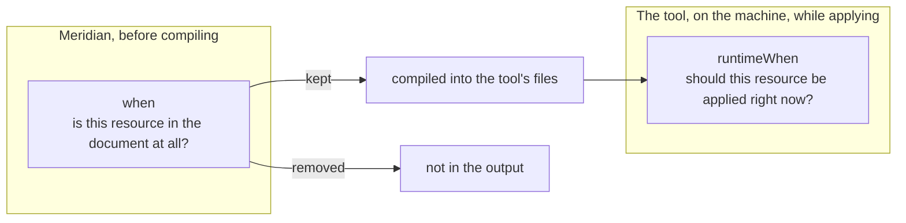

# Conditions: `when` and `runtimeWhen`

A resource can carry two conditions. They look alike and are decided at two
different times, by two different parties, in two different languages.



| | `when` | `runtimeWhen` |
|---|---|---|
| Decided by | Meridian | the tool |
| Decided when | before anything is compiled | on the machine, at the moment the resource is applied |
| Written in | Meridian's own condition language | the tool's own language |
| Effect when false | the resource is not in the compiled output | the resource is in the output; the tool skips it |
| Available today | no | yes, on the targets that can |

## `runtimeWhen`

```yaml
- id: apt_cache
  type: exec
  params:
    command: apt-get update
  runtimeWhen: "ansible_facts['os_family'] == 'Debian'"
```

Text. Meridian does not read it, check it, or translate it. It is copied into
the construct the tool has for a last-moment check, so it must be valid in that
tool's language, and it is the one part of a shared-dialect document that does
not move between tools.

| Target | It becomes | Written in | Example |
|---|---|---|---|
| `ansible` | the task's `when:` | a Jinja2 expression over Ansible facts and variables | `"ansible_facts['os_family'] == 'Debian'"` |
| `chef` | an `only_if` guard | Ruby, with node attributes | `"node['platform_family'] == 'debian'"` |
| `dsc` | a `preCondition` | the DSC runner's function language | `"equals (nodeName) 'web'"` |

Every other target refuses a resource that carries `runtimeWhen`, because its
tool has no such moment:

```
rw.yaml:8:7: puppet: resource "a" [unsupported-runtime-condition]: resource carries runtimeWhen "x", which this target cannot express: a Puppet catalog is compiled before it reaches the node, so there is no apply-time conditional to compile it into
```

| Target | Why not |
|---|---|
| `puppet` | a catalog is compiled before it reaches the node |
| `cloud-init` | it evaluates nothing per resource; the machine applies its user-data once |
| `terraform`, `cloudformation`, `bicep` | there is no node; the tool talks to an API |
| `docker`, `kubernetes` | nothing to check a condition against while a project or a set of objects is submitted |
| `podman` | refused; systemd's own `Condition*=` settings under `unit` do this job |

The [capability matrix](../capability-matrix.md) has the `runtimeWhen` column.

**What it does to a plan.** A condition checked at apply time cannot be known
in advance, so a plan shows the resource as the tool's own dry run shows it.

**With `notifies`.** A notified resource's own `runtimeWhen` is not copied onto
the reaction. On Ansible, for example, the handler built for a notified service
does not carry the service task's `when:`.

## `when`

```yaml
- id: selinux_tools
  type: package
  params: {name: policycoreutils}
  when: "facts.os.family == 'RedHat'"
```

`when` is part of the language and is **not available yet**.

It is meant to be decided by Meridian itself, before compiling, from facts
gathered about the node, so that the compiled output is static: a resource is
either in it or not, and what you review is what will run. That is also what
`ifMissing` on [`dependsOn`](dependson.md) and [`notifies`](notifies.md) is
for: saying what should happen to an edge whose other end `when` removed.

The stage that evaluates it is not connected to the `meridian` command. Until it
is, a plugin must never be handed a condition it cannot evaluate, so:

| Command | A document that uses `when` |
|---|---|
| `validate` | passes: the field is part of the language |
| `compile`, `plan`, `apply` | refused |

```
when.yaml:9:7: resource "a" still carries an unevaluated `when` expression; the condition stage must prune before an AST is built
```

Do not write `when` today. Use `runtimeWhen` where the target has it, or keep
separate documents for separate kinds of machine.

## Choosing

| The condition depends on | Use |
|---|---|
| something only known on the machine at that moment (a file exists, a fact, a node attribute) | `runtimeWhen`, on `ansible`, `chef` or `dsc` |
| which kind of machine or environment the document is for | separate documents today; `when` once it is available |
| whether another resource changed | not a condition: [`notifies`](notifies.md) |
