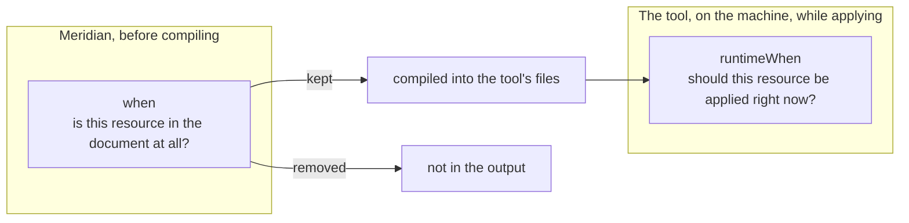
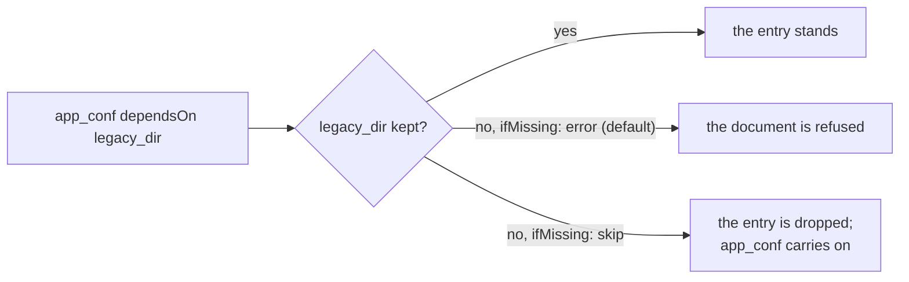

# Conditions: `when` and `runtimeWhen`

A resource can carry two conditions. They look alike and are decided at two
different times, by two different parties, in two different languages.



| | `when` | `runtimeWhen` |
|---|---|---|
| Decided by | Meridian | the tool |
| Decided when | before anything is compiled | on the machine, at the moment the resource is applied |
| Written in | Meridian's [expression language](expressions.md) | the tool's own language |
| Effect when false | the resource is not in the compiled output | the resource is in the output; the tool skips it |
| Can read | the values given with `--data` and `--set` | whatever the tool can see on the machine |
| Available | on every target | on the targets that can |

## `runtimeWhen`

```yaml
- id: apt_cache
  type: exec
  params:
    command: apt-get update
  runtimeWhen: "ansible_facts['os_family'] == 'Debian'"
```

Text. Meridian does not read it, check it, or translate it. It is copied into
the construct the tool has for a last-moment check, so it must be valid in that
tool's language, and it is the one part of a shared-dialect document that does
not move between tools.

| Target | It becomes | Written in | Example |
|---|---|---|---|
| `ansible` | the task's `when:` | a Jinja2 expression over Ansible facts and variables | `"ansible_facts['os_family'] == 'Debian'"` |
| `salt` | a Jinja `if` around the state, evaluated when the minion renders the file | a Jinja expression over grains and pillar, written without `{{ }}` | `"grains['os_family'] == 'RedHat'"` |
| `chef` | an `only_if` guard | Ruby, with node attributes | `"node['platform_family'] == 'debian'"` |
| `dsc` | a `preCondition` | the DSC runner's function language | `"equals (nodeName) 'web'"` |

Every other target refuses a resource that carries `runtimeWhen`, because its
tool has no such moment:

```
rw.yaml:8:7: puppet: resource "a" [unsupported-runtime-condition]: resource carries runtimeWhen "x", which this target cannot express: a Puppet catalog is compiled before it reaches the node, so there is no apply-time conditional to compile it into
```

| Target | Why not |
|---|---|
| `puppet`, `openvox` | a catalog is compiled before it reaches the node |
| `cloud-init` | it evaluates nothing per resource; the machine applies its user-data once |
| `terraform`, `opentofu`, `pulumi`, `cloudformation`, `bicep`, `arm` | there is no node; the tool talks to an API |
| `packer` | refused; a step's own `only` or `except` param does this job |
| `docker`, `kubernetes`, `helm` | nothing to check a condition against while a project or a set of objects is submitted |
| `podman` | refused; systemd's own `Condition*=` settings under `unit` do this job |

The [capability matrix](../capability-matrix.md) has the `runtimeWhen` column.

**What it does to a plan.** A condition checked at apply time cannot be known
in advance, so a plan shows the resource as the tool's own dry run shows it.

**With `notifies`.** A notified resource's own `runtimeWhen` is not copied onto
the reaction. On Ansible, for example, the handler built for a notified service
does not carry the service task's `when:`.

## `when`

```yaml
- id: debug_log
  type: file
  params: {path: /var/log/app/debug.log}
  when: "data.env != 'prod'"
```

`when` is decided by Meridian itself, before compiling, so that the compiled
output is static: a resource is either in it or not, and what you review is what
will run. No target ever sees the condition, so it works on every target.

### The condition language

A condition is an [expression](expressions.md) that comes out `true` or
`false`. It reads the values given to the command with `--data` and `--set`,
as `data.<key>`. Quote the whole condition in YAML, because `!`, `'`, `[` and
`>` mean something to YAML.

| You write | Meaning |
|---|---|
| `data.env`, `data.region.name`, `data.ports[0]` | a value from the data: a key, keys inside mappings, an item of a list |
| `true`, `false`, `null`, `3`, `1.5`, `'prod'`, `[1, 2]`, `{a: 1}` | themselves |
| `a == b`, `a != b` | whether two values are the same. `3` and `3.0` are; `'3'` and `3` are not |
| `a < b`, `a <= b`, `a > b`, `a >= b` | order, between two numbers or two texts |
| `a in b`, `a not in b` | an item of a list, a key of a mapping, or text inside text |
| `a =~ 'pattern'`, `a !~ 'pattern'` | text matches a regular expression |
| `a + b`, `a - b`, `a * b`, `a / b`, `a % b` | arithmetic; `+` also joins two texts or two lists |
| `!a`, `a && b`, `a \|\| b` | not, and, or. `&&` binds tighter than `\|\|`; the right side is only read when the left leaves the answer open |
| `c ? a : b` | `a` when `c` is true, otherwise `b` |
| `a ?? b` | `a`, or `b` when `a` is not set or null |
| `( ... )` | grouping |
| `defined(data.key)` | whether the data sets that key |
| `length(x)`, `upper(x)`, `contains(x, y)`, ... | [functions](expressions.md#functions): about eighty, the same wherever an expression is written |

```yaml
- id: tls_dir
  type: file
  state: directory
  params: {path: /etc/app/tls}
  when: "data.env in ['staging', 'prod'] && (data.tls.enabled ?? false)"

- id: swap_file
  type: exec
  params: {command: fallocate -l 2G /swapfile}
  when: "data.memory_mb < 4 * 1024"

- id: nat_address
  type: aws_eip
  params: {domain: vpc}
  when: "length(filter(data.subnets, 's', !s.public)) > 1 && data.account != 'sandbox'"
```

The full language, with every operator, every function and every error, is on
[expressions and functions](expressions.md).

| Rule | Checked by | Message |
|---|---|---|
| The condition must be written in the language | `validate` | `spec.resources[0].when: unexpected "=" (to compare two values in a condition, write ==)` |
| Every name must be one a condition can read | `validate` | `unknown name "env" (a condition reads data.<key>; text is quoted)` |
| Every function must exist and be given a number of arguments it takes | `validate` | `unknown function "Length" (did you mean length?)` |
| `facts.*` is not available: nothing gathers facts from a node yet | `validate` | `facts are not available: ... a condition can only read data.<key>` |
| A key the condition reads must be set | `compile` | `data.env is not set (give it with --data or --set, or test for it with defined(data.env))` |
| Types must go together; nothing is converted silently | `compile` | `cannot compare a string and a number with >; convert one first, with toString or toNumber` |
| The condition must come out `true` or `false` | `compile` | `data.env is a string, not true or false; compare it with == or !=` |

Guard an optional key with `data.x ?? false`, or with
`defined(data.x) && data.x == 'y'`.

**The same on every target.** A condition is decided before the document's
plugin is handed anything, so the target takes no part in it. The resources
kept are the same whether the document names `ansible`, `terraform` or
`kubernetes`, and a test asserts that for every target.

### Giving the data

```
meridian apply site.yaml --data common.yaml --data prod.yaml --set replicas=5
```

A data file is YAML or JSON holding one mapping. `--data` may be repeated; a
key in a later file replaces the same key from an earlier file, whole.

`--set KEY=VALUE` gives one value, after every data file, so it wins:

| You write | Sets |
|---|---|
| `--set env=prod` | `data.env` to the text `prod` |
| `--set replicas=5`, `--set tls=true` | a number, a boolean: the value is typed as YAML types it |
| `--set 'version="1.10"'` | text that would otherwise be read as a number |
| `--set region.name=eu-west-1` | one key inside the mapping `data.region`, keeping its other keys |
| `--set 'ports=[80, 443]'` | a list |
| `--set note=` | null |

A later `--set` of the same key wins. A dotted key whose start is already set
to something that is not a mapping is refused: `--set env.name=x: env is
already set to a string, so it cannot hold the key "name"`.

With no `--data` and no `--set` there is no data, and a condition that reads a
key is refused, not taken as false.

### `ifMissing`

A resource whose `when` is false is not in the output, and neither are its own
`dependsOn` and `notifies`. An entry of *another* resource that names it has
lost its other end, and `ifMissing` on that entry says what happens:

```yaml
- id: legacy_dir
  type: file
  state: directory
  params: {path: /opt/legacy}
  when: data.legacy

- id: app_conf
  type: file
  params: {path: /etc/app.conf, content: "x"}
  dependsOn:
    - resource: legacy_dir
      ifMissing: skip
```



| Value | When the named resource was removed |
|---|---|
| `error` (the default) | refused: `resource "app_conf" depends on "legacy_dir", which its when removed from this run; set ifMissing: skip on this entry if the resource should carry on without it` |
| `skip` | the entry is dropped and the resource carries on without it |

It is the same on `dependsOn` and on `notifies`. The default is `error` because
a resource depending on something that is not there is far more often a mistake
than an intention. `ifMissing` does nothing to an entry whose resource is
present, and never excuses an entry naming a resource the document does not
declare.

Also:

- An output or a `${...}` reference that reads a removed resource is refused by
  the target, as a reference to a resource that is not there.
- A dependency cycle is refused whatever the conditions say.
- If every resource is removed the document compiles to nothing, and applying
  it tells the tool that nothing should exist.

| Command | A document that uses `when` |
|---|---|
| `validate` | the condition's syntax is checked |
| `compile`, `plan`, `apply` | the condition is decided from `--data` and `--set`, and the resource is kept or removed |

## Choosing

| The condition depends on | Use |
|---|---|
| something only known on the machine at that moment (a file exists, a fact, a node attribute) | `runtimeWhen`, on `ansible`, `chef`, `salt` or `dsc` |
| which environment or kind of machine the document is for, as far as you can say it in a data file | `when`, on any target |
| which documents of a workflow to run at all | not a condition: [labels and a selector](index.md#labels-and-selectors) |
| whether another resource changed | not a condition: [`notifies`](notifies.md) |
