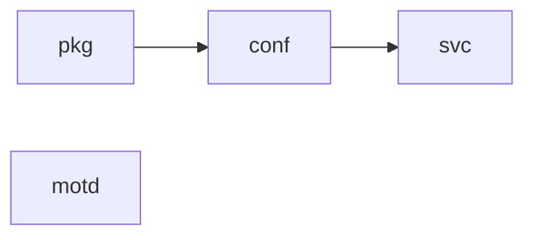
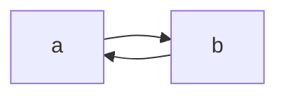
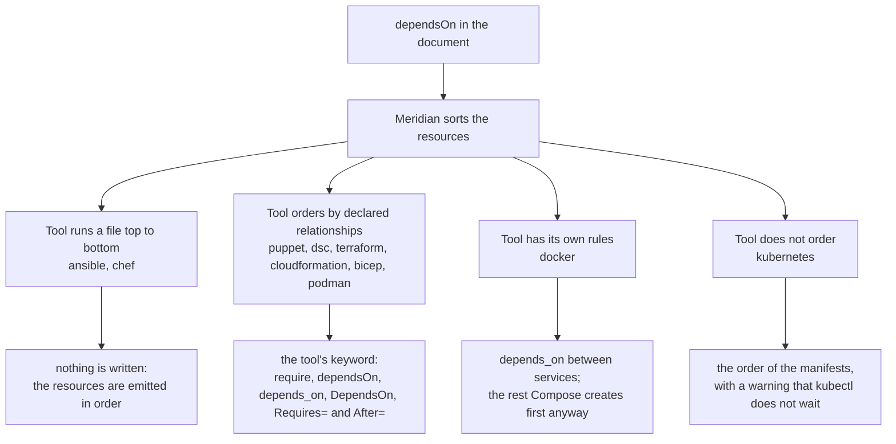

# `dependsOn`

```yaml
- id: nginx_conf
  type: file
  params: {path: /etc/nginx/nginx.conf, content: "..."}
  dependsOn:
    - resource: nginx_pkg
```

"Do not touch this resource until that one is done." A dependency is about
order and nothing else. It does not carry data (that is a
[reference](references.md)) and it does not react to change (that is
[`notifies`](notifies.md)).

## Fields

`dependsOn` is a list. Each entry is a mapping:

| Field | Required | Value |
|---|---|---|
| `resource` | yes | the `id` of another resource in the same document |
| `ifMissing` | no | `error` (the default) or `skip`. Checked for spelling, [not acted on yet](index.md#fields-that-are-read-but-not-used-yet) |

A resource may depend on any number of others, and any number may depend on it.

## Rules

| Rule | Checked by | Message |
|---|---|---|
| The resource named must be in the document | `validate` | `resource "a" depends on unknown resource "s2"` |
| A resource cannot depend on itself | `validate` | `resource "a" cannot depend on itself` |
| The dependencies must not form a cycle | `compile` | `dependency cycle among 2 resources: a -> b -> a` |
| A dependency cannot point into another document | by construction | ids are local to a document |

## How the order is worked out

Meridian builds a graph from every `dependsOn` in the document and sorts it
before any plugin sees the document. The rule is deterministic:

1. A resource is placed as early as its dependencies allow.
2. Among resources that are ready at the same moment, the one written first in
   the document goes first.

So the same document always gives the same order, and the order of the file is
the only tiebreak.

### A worked example

Four resources, written in an order that is not the order they must run in:

```yaml
resources:
  - id: svc
    type: service
    params: {name: nginx}
    dependsOn: [{resource: conf}]
  - id: conf
    type: file
    params: {path: /etc/nginx/nginx.conf, content: "x"}
    dependsOn: [{resource: pkg}]
  - id: motd
    type: file
    params: {path: /etc/motd, content: "hi"}
  - id: pkg
    type: package
    params: {name: nginx}
```

The graph (an arrow reads "must come before"):



The sort, step by step:

| Step | Ready (dependencies all placed) | Placed | Why |
|---|---|---|---|
| 1 | `motd`, `pkg` | `motd` | both are ready; `motd` is written first |
| 2 | `pkg` | `pkg` | |
| 3 | `conf` | `conf` | `pkg` is placed, so `conf` is ready |
| 4 | `svc` | `svc` | |

The order handed to the plugin is `motd`, `pkg`, `conf`, `svc`, and on Ansible
that is the order of the tasks in the playbook.

### A cycle



There is no order that satisfies this, so the document does not compile, and the
message names the resources on the cycle so it can be broken:

```
cycle.yaml:8:7: dependency cycle among 2 resources: a -> b -> a
```

`meridian validate` does not look for cycles; `compile`, `plan` and `apply` do.

## What a dependency becomes

Meridian always sorts. What the plugin then writes depends on how its tool
thinks about order:



| Tool orders by | Targets | What `dependsOn` becomes |
|---|---|---|
| position in the file | `ansible`, `chef` | nothing written; the resources are emitted in order |
| declared relationships | `puppet`, `dsc`, `terraform`, `cloudformation`, `bicep`, `podman` | the tool's own keyword |
| its own rules | `docker` | `depends_on` between services |
| nothing | `kubernetes` | the order of the manifests, with a warning |

Two consequences worth knowing:

- **A file-ordered tool cannot run independent resources side by side.** The
  compile says which resources that affects:

  ```
  warning: ansible: resources "motd", "pkg" are independent but will run in sequence; this target flattens the dependency graph and cannot express parallelism
  ```

  The result is the same; only the time differs.

- **Where a reference already implies the order, the keyword is not written
  twice.** On Terraform, CloudFormation and Bicep, `${web_sg.id}` inside `web`
  already puts `web_sg` first, so an explicit `dependsOn` between the two adds
  nothing to the tool's file. Write `dependsOn` for an order the tool cannot
  see from the data: an IAM role that must exist before an instance starts,
  though nothing in the instance mentions it.

## When to use it, and when not

| You want | Use |
|---|---|
| B must not start until A is finished | `dependsOn` |
| B needs a value A produces | a [reference](references.md); the order follows |
| B should be restarted when A changes | [`notifies`](notifies.md) |
| document 2 must run after document 1 | nothing to write: [Infrastructure runs before ResourceSet](how-it-fits-together.md#step-4-documents-become-stages), and a `targetHost` taken from an output makes the wait explicit |

The concept behind this page, with the comparison to `notifies`, is in
[dependencies and notifications](../../concepts/dependencies.md).
