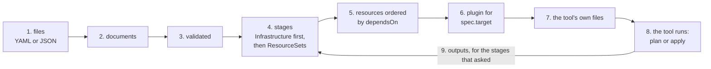
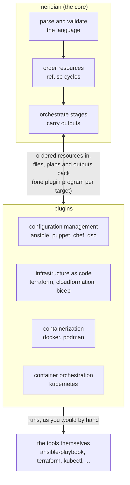
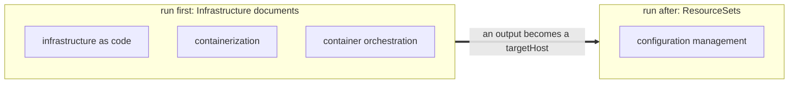

# How it fits together

The other pages of this reference take the language one item at a time. This
page follows a document from the file you wrote to a tool that has run, and says
which item matters at which step. Read it once and the rest falls into place.



The same thing as an architecture: the core knows the language and nothing about
any tool; each plugin knows one tool and nothing about the others.



| Step | What happens | Items of the language involved | Command that gets this far |
|---|---|---|---|
| 1. Read | each file is read as YAML or JSON | [files](index.md#files) | all |
| 2. Decode | each document becomes a typed object; unknown fields are errors | [`apiVersion`, `kind`, `metadata`, `spec`](index.md#the-document) | all |
| 3. Validate | the shape of each document, and the links between documents | ids, [`dependsOn`](dependson.md), [`notifies`](notifies.md), [`targetHost`](outputs-and-hand-offs.md) | `validate` stops here |
| 4. Stage | each document becomes a stage; stages are put in order | `kind`, [`targetHost`](outputs-and-hand-offs.md) | |
| 5. Order | the resources of a document are sorted; a cycle is refused | [`dependsOn`](dependson.md), [`when`](conditions.md) | |
| 6. Hand over | the document's plugin is found and given the ordered resources | `spec.target`, the [flavour](index.md#the-meridian-language) | |
| 7. Compile | the plugin checks every resource against what its tool can do, and writes the tool's files | [`type`, `state`, `params`](resources.md), [references](references.md), [`notifies`](notifies.md), [`runtimeWhen`](conditions.md) | `compile` stops here |
| 8. Run | the plugin runs the tool: a preview, or the real thing | | `plan`, `apply` |
| 9. Hand on | the tool reports outputs; waiting stages receive them | [`outputs`](outputs-and-hand-offs.md) | `apply` |

## The pieces

**A document** is one thing for one tool: an Infrastructure document or a
ResourceSet. **A resource** is one thing the document wants to be true. **A
target** is the plugin for one tool, and belongs to a **segment**
(configuration management, infrastructure as code, containerization, container
orchestration), which decides the **flavour**: what a resource's `type`,
`state` and `params` mean. **A workflow** is the documents given to one command.
**A stage** is one document being run.

Inside a document, resources are tied together three ways, and they are
different on purpose:

| Tie | Says | Decided |
|---|---|---|
| [`dependsOn`](dependson.md) | order: that one first | by Meridian, before the plugin sees anything |
| [`notifies`](notifies.md) | reaction: when this changes, do that | by the tool, during the run |
| [a reference, `${...}`](references.md) | data: this value comes from that resource | by the tool, during the run; checked by the plugin at compile |

Between documents there is exactly one tie: an Infrastructure document's
[output](outputs-and-hand-offs.md) becomes a ResourceSet's `targetHost`.

## Steps 1 to 3: reading and validating

```
$ meridian validate examples/workflow/vm-then-web.yaml
2 documents valid
```

Validation is about the language only. No plugin is loaded, so nothing here
knows what Terraform or Ansible can do. It answers: is this a well-formed
Meridian document, do its internal links point somewhere, and do the documents
given together fit together?

Every problem in every file is reported in one pass, each with the file, line,
column and field:

```
error: 2 errors:
  dup.yaml:11:7: spec.resources[1].id: duplicate resource id "a" (first declared at dup.yaml:8:7)
  dup.yaml:14:19: spec.resources[1].dependsOn[0].resource: resource "a" cannot depend on itself
```

The exact list of what is checked here and what is left to `compile` is in
[which check happens when](index.md#which-check-happens-when).

## Step 4: documents become stages

Each document is one stage. The order of stages is fixed by kind:

1. every Infrastructure document, in the order given
2. every ResourceSet, in the order given

The reason is the one tie between documents: a ResourceSet may need a value that
only exists after an Infrastructure document has been applied. Putting all
Infrastructure first satisfies every such need.

A ResourceSet whose `targetHost` names an output that does not exist yet is
**deferred**: set aside, not failed, and not compiled against a guess.

There is a step the design places here that is not wired into the command yet:
**resolution**, where values are merged from layers of data (per environment,
per node) and each resource's `when` is decided from facts about the node. The
engine for the layered data exists in the core. Until it is connected, a
document says exactly what it says, with no outside data, and a resource that
carries `when` is refused at step 5. See [conditions](conditions.md).

## Step 5: resources are ordered

The resources of one document are sorted so that every `dependsOn` is
satisfied. A resource is placed as early as its dependencies allow, and among
resources that are ready at the same moment, the one written first goes first.
So the result depends only on what you wrote.

Written in this order, with `svc` depending on `conf` and `conf` on `pkg`:

```
svc, conf, motd, pkg
```

the order handed to the plugin is:

```
motd, pkg, conf, svc
```

A cycle is refused here, by name:

```
cycle.yaml:8:7: dependency cycle among 2 resources: a -> b -> a
```

`notifies` plays no part in this sort. It is a reaction, not an order, so two
resources may notify each other.

## Steps 6 and 7: the plugin compiles

`spec.target` names a plugin, a separate program called
`meridian-target-<name>`. If none is installed the stage fails there:

```
no plugin provides target "nosuch" (loaded targets: ansible, bicep, chef, ...)
```

The plugin receives the document already decided: its resources in order, its
dependency and notify edges, its outputs, and the host as a literal. It does not
evaluate anything. Its job is to map and to write, in four passes:

| Pass | Does | Typical refusal |
|---|---|---|
| transform | turns each resource into the tool's own construct | `unsupported-resource-type`, `unsupported-param`, `unsupported-state` |
| sort | expresses order and notifies the way the tool does | `unsupported-action` |
| validate | checks the result as a whole | `invalid-reference`, `missing-param` |
| emit | writes the files | |

This is where the flavour applies, and where a document meets what its tool can
really do. Anything the tool cannot do is refused, with the rule in brackets:

```
param.yaml:8:7: ansible: resource "a" [unsupported-param]: resource type "package" does not accept param "version" on this target (accepted: name)
```

A warning is different: the output does what the document says, and there is
something about how that you should know.

```
warning: ansible: resources "motd", "pkg" are independent but will run in sequence; this target flattens the dependency graph and cannot express parallelism
```

The rule behind both is [the capability model](../../concepts/capability-model.md).

With `--out`, the files are written where you can read them:

```
$ meridian compile examples/workflow/vm-then-web.yaml --out build
machine (Infrastructure, target terraform)
  compiled 1 file into build/machine
site (ResourceSet, target ansible)
  deferred: needs the output "address" of Infrastructure "machine", which has not been applied yet
```

## Step 8: the tool runs

For `plan` and `apply` the plugin runs the tool, exactly as you would by hand,
with the credentials and configuration the tool already has. Each document gets
its own working directory under the state directory (`.meridian` by default),
one per document and target, so two tools never share files.

`plan` asks the tool for its own preview and reports the changes by the ids the
document uses. `apply` makes the changes. Each tool keeps its own state in its
own way; Meridian records only what it did itself (which document was applied,
and whether it worked), and that record is never the source of truth about the
infrastructure.

The first stage that fails stops the run. Stages after it are reported as not
run:

```
machine (Infrastructure, target terraform)
  FAILED: could not run terraform: it is not installed, or not on the PATH of the machine running Meridian (ran `terraform init -input=false -no-color`)
site (ResourceSet, target ansible)
  not run, because Infrastructure "machine" failed
```

## Step 9: outputs are handed on

After an Infrastructure document is applied, its tool reports the outputs the
document declared. A ResourceSet that was waiting for one now has its host, so
it is compiled for the real value and applied. On a later run, `plan` asks the
tool what its last apply produced, so stages that depend on existing
infrastructure are no longer deferred.

## A worked example, start to finish

[`examples/workflow/vm-then-web.yaml`](../../../examples/workflow/vm-then-web.yaml)
holds two documents. Terraform creates a machine; Ansible configures it.

```yaml
apiVersion: meridian/v1
kind: Infrastructure
metadata:
  name: machine
spec:
  target: terraform                       # step 6: which plugin
  resources:
    - id: aws
      type: provider                      # step 7: the IaC flavour's settings resource
      params:
        region: eu-west-1
    - id: web
      type: aws_instance                  # step 7: Terraform's own type and arguments
      params:
        ami: ami-0abcdef1234567890
        instance_type: t3.micro
        tags:
          Name: web
  outputs:
    - name: address                       # step 9: promised to later stages
      value: ${web.public_ip}             # a reference, rewritten by the plugin
---
apiVersion: meridian/v1
kind: ResourceSet
metadata:
  name: site
spec:
  target: ansible
  targetHost:                             # step 4: makes this stage wait for `machine`
    from: infrastructure
    ref: machine
    output: address
  resources:
    - id: nginx_pkg
      type: package                       # step 7: the shared configuration management types
      params:
        name: nginx
    - id: nginx_svc
      type: service
      state: running
      params:
        name: nginx
        enabled: true
      dependsOn:                          # step 5: order within this document
        - resource: nginx_pkg
```

What each step does with it:

1. **Read, decode.** One file, two documents separated by `---`.
2. **Validate.** Both documents are well formed. `site` asks for the output
   `address` of an Infrastructure document called `machine`; both exist.
3. **Stage.** `machine` first, because it is Infrastructure. `site` second.
4. **Order.** In `machine`, nothing depends on anything, so the resources keep
   their written order. In `site`, `nginx_pkg` goes before `nginx_svc`.
5. **Compile `machine`.** The Terraform plugin writes `main.tf.json`. The
   reference `${web.public_ip}` became Terraform's own address for it:

   ```json
   {
     "output": {
       "address": { "value": "${aws_instance.web.public_ip}" }
     },
     "provider": { "aws": { "region": "eu-west-1" } },
     "resource": {
       "aws_instance": {
         "web": {
           "ami": "ami-0abcdef1234567890",
           "instance_type": "t3.micro",
           "tags": { "Name": "web" }
         }
       }
     }
   }
   ```

6. **`site` is deferred.** Its host is not known, so with `compile` or `plan`
   the run ends here, honestly.
7. **With `apply`:** Terraform runs, creates the instance and reports
   `address`. `site` is compiled into a playbook and an inventory naming that
   address, and Ansible runs them.

The same walk through, with more about running it, is in
[a two-stage workflow](../../quickstart/first-two-stage.md).

## Where each segment sits in a workflow



| Segment | Kind | Runs | Can hand on outputs | Can receive a host |
|---|---|---|---|---|
| Infrastructure as code | `Infrastructure` | first | yes | no |
| Containerization | `Infrastructure` | first | yes | no (`podman` also takes a ResourceSet, to reach another machine) |
| Container orchestration | `Infrastructure` | first | yes | no |
| Configuration management | `ResourceSet` | after every Infrastructure document | no | yes |

So the workflows the language can express today are: any number of
Infrastructure documents, then any number of ResourceSets, where a ResourceSet
may take its host from one Infrastructure document. One Infrastructure document
cannot yet read another's output.
