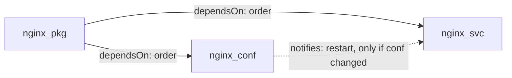
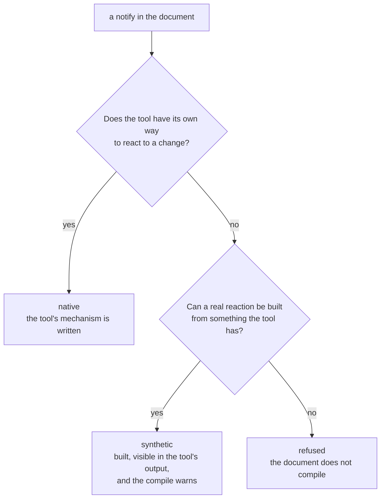

# `notifies`

```yaml
- id: nginx_conf
  type: file
  params: {path: /etc/nginx/nginx.conf, content: "..."}
  notifies:
    - resource: nginx_svc
      action: restart
```

"When this resource really changes, do that to the other one." On a run where
the file is already right, nothing is restarted.

A notify is a reaction. It is not an order ([`dependsOn`](dependson.md)) and it
does not carry data (a [reference](references.md)).

## Fields

`notifies` is a list. Each entry is a mapping:

| Field | Required | Value |
|---|---|---|
| `resource` | yes | the `id` of the resource to act on, in the same document |
| `action` | yes | what to do to it. One word, from the list the target accepts for that type of resource |
| `on` | no | text. [Not acted on yet](index.md#fields-that-are-read-but-not-used-yet): a notify fires on any change |
| `ifMissing` | no | `error` (the default) or `skip`. Checked for spelling, [not acted on yet](index.md#fields-that-are-read-but-not-used-yet) |

The resource that carries `notifies` is the **notifier**. The one it names is
the **notified** resource.

## Rules

| Rule | Checked by | Message |
|---|---|---|
| The resource named must be in the document | `validate` | `resource "a" notifies unknown resource "b"` |
| A resource cannot notify itself | `validate` | `resource "a" cannot notify itself` |
| `action` must be given | `validate` | `missing required field` |
| The target must be able to perform that action on that type of resource | `compile` | `[unsupported-action]`, with the reason |

A notify is **not part of the order**. It is left out of the sort that
`dependsOn` drives, which has two effects:

- Two resources may notify each other. A loop of notifies is legal where a loop
  of dependencies is not.
- A notify alone does not put the notifier first. If the notified resource must
  also exist first, or run after, say so with `dependsOn`. (Some tools order a
  notifier before what it notifies by themselves; Puppet does. The reaction
  itself happens when the tool decides: an Ansible handler and a delayed Chef
  notification run at the end of the run.)



## Native and synthetic

Tools differ more here than anywhere else, and Meridian is strict about it.



**Native** means the tool has the mechanism: Ansible's handlers, Puppet's
`notify`, Chef's `notifies`, the DSC runner's `notify`, Compose's `depends_on`
with `restart: true`.

**Synthetic** means the tool has no such mechanism, and the plugin builds the
reaction from something the tool does have. It is real, and it shows up in the
tool's own output, so the compile always warns and says what it will look like:

```
warning: kubernetes: web: restarts by rolling its pods whenever the content of "web_config" changes; the trigger is the annotation meridian.dev/restart-on-web-config on its pod template
```

**Refused** means there is nothing honest to build:

```
cfn.yaml:9:18: cloudformation: resource "a" [unsupported-action]: notifies resource "b" with action "restart", which this target cannot express: CloudFormation has no way to act on one resource because another changed
```

## Actions, by target

The action is a word the target understands, and a target accepts only what its
tool can really do to that type of resource.

| Target | Kind | Notified resource | Actions |
|---|---|---|---|
| `ansible` | native | `service` | `restart`, `reload`, `start`, `stop` |
| | | `exec` | `run` |
| `chef` | native | `service` | `restart`, `reload`, `start`, `stop` |
| | | `exec` | `run` |
| `puppet` | native | `service` | `restart` (or `refresh`) |
| | | `exec` | `run` |
| `dsc` | native | any DSC resource | `refresh` |
| `docker` | native from a service, synthetic from a config, secret, network or volume | `service` | `restart` |
| `podman` | native | a unit | `restart` |
| `kubernetes` | synthetic | a Deployment, StatefulSet or DaemonSet | `restart` |
| `terraform` | synthetic | a managed resource | `replace` |
| `cloudformation`, `bicep` | refused | | |

**The action is kept, never approximated.** `reload` on Puppet is refused, not
turned into a restart, because a restart does more than the document asked for:

```
puppet: resource "nginx_conf" [unsupported-action]: notifies resource "nginx_svc" with action "reload", which this target cannot express: Puppet's refresh restarts a service; it takes no argument and cannot be told to reload instead. ...
```

**The notified type matters.** A package cannot be restarted:

```
na.yaml:12:7: ansible: resource "b" [unsupported-action]: resource type "package" cannot be notified on this target, got action "restart"
```

## What a notify becomes

On Ansible, a handler, named after the action and the notified resource, run
once at the end of the play and only if a task that notifies it changed
something:

```yaml
tasks:
  - name: nginx_conf
    ansible.builtin.copy: {...}
    notify:
      - reload nginx_svc
handlers:
  - name: reload nginx_svc
    ansible.builtin.service:
      name: nginx
      state: reloaded
```

On Kubernetes, a checksum of the notifier in an annotation on the notified
workload's pod template. The content changes, the checksum changes, the template
changes, and the workload's controller rolls its pods:

```yaml
spec:
  template:
    metadata:
      annotations:
        meridian.dev/restart-on-web-config: 3e7aa8895791e35c
```

On Terraform, `replace_triggered_by` on the notified resource, which destroys
and recreates it. `terraform plan` shows it as "must be replaced". That is the
notify working, and the reason the only action accepted there is `replace`.

Each target's page shows its own form.

## When to use it

| You want | Use |
|---|---|
| a service picks up a changed configuration file | `notifies` with `restart` or `reload` |
| a command runs when something changed | `notifies` an `exec` with `run` |
| pods roll when a ConfigMap changes | `notifies` the workload with `restart` |
| B simply runs after A, every time | [`dependsOn`](dependson.md) |

The [capability matrix](../capability-matrix.md) has the one-line summary for
every target, and
[dependencies and notifications](../../concepts/dependencies.md) the concept.
