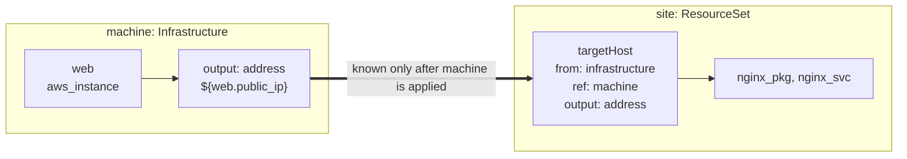
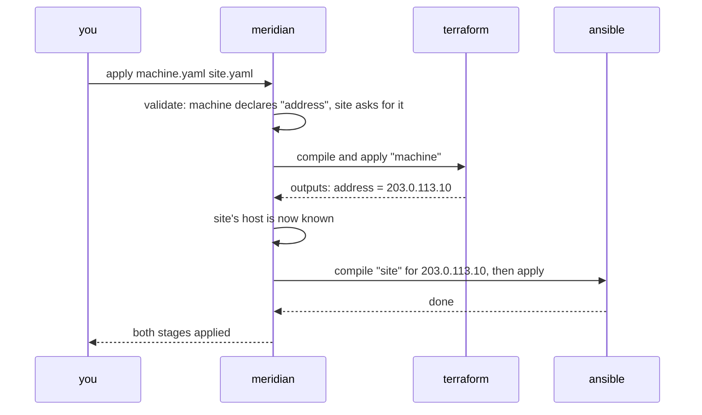

# Outputs and hand-offs: `outputs` and `targetHost`

Resources inside a document are tied together by
[`dependsOn`](dependson.md), [`notifies`](notifies.md) and
[references](references.md). Documents are tied together by exactly one thing:
a value one document promises and another asks for.



## `outputs`

Only in an Infrastructure document: `spec.outputs`, a list.

```yaml
outputs:
  - name: address
    value: ${web.public_ip}
  - name: url
    value: http://${web.public_ip}:8080
```

| Field | Required | Value |
|---|---|---|
| `name` | yes | the output's name, unique among the document's outputs. This is what another document asks for |
| `value` | give one | text holding one or more [references](references.md). The core does not insist on it, but an output without a value has nothing to report |

```
out.yaml:13:7: spec.outputs[1].name: duplicate output name "o" (first declared at out.yaml:12:7)
```

**What an output is.** A promise that, once this document has been applied, its
tool can report this value. It is not known before: an address does not exist
until the machine does.

**What it becomes.** The tool's own output where it has one (a Terraform
`output`, a CloudFormation `Outputs` entry, a Bicep `output`). Where the tool
has no such thing, the plugin reads the value back itself after the apply (a
`docker inspect` path, a `kubectl get` path).

**What can be read.** Whatever the tool can report about that resource after it
exists. This is often more than a param may read, because a param is fixed
before the apply and an output is read after it:

| Target | An output can read |
|---|---|
| `terraform` | any attribute of a resource or data source |
| `cloudformation` | `Ref` and `GetAtt` attributes |
| `bicep` | any property; always reported as text |
| `docker` | a published port (`${app.port.8080}`), or a path into the container's inspection |
| `kubernetes` | any path into the live object, such as `${svc.status.loadBalancer.ingress[0].ip}` |

**Strictness.**

- An output the tool has no value for after an apply is an error, not an empty
  value. A ResourceSet is never pointed at an empty host.
- Some values take time to exist (a load balancer's address). The Kubernetes
  target waits for them, for a limited time.
- A value the tool marks sensitive is shown as `(sensitive)` wherever Meridian
  prints, and anything read from a Kubernetes Secret is treated as sensitive.

**Where outputs are kept.** With the tool that owns them. After an apply they
are shown and handed to the stages that asked. On a later run Meridian asks the
tool again what its last apply produced, which is how a `plan` sees
infrastructure that already exists. Meridian's own record under the state
directory says only which document was applied and whether it worked.

**Which targets have outputs.** The `outputs` column of the
[capability matrix](../capability-matrix.md). Today: every infrastructure as
code, containerization and container orchestration target. A ResourceSet has no
`outputs` field, so configuration management targets produce none.

## `targetHost`

Only in a ResourceSet: `spec.targetHost`, the machine the document configures.
A ResourceSet cannot be compiled without one.

### A machine that already exists

```yaml
targetHost:
  from: inline
  host: web01.example.com
```

| Field | Required | Value |
|---|---|---|
| `from` | yes | `inline` |
| `host` | yes | a host name or address, as you would give it to the tool |

The document needs no other document. It compiles straight away.

### A machine another document creates

```yaml
targetHost:
  from: infrastructure
  ref: machine
  output: address
```

| Field | Required | Value |
|---|---|---|
| `from` | yes | `infrastructure` |
| `ref` | yes | the `metadata.name` of an Infrastructure document given to the same command |
| `output` | yes | the `name` of an output that document declares |

### Rules

| Rule | Checked by | Message |
|---|---|---|
| `from` is `inline` or `infrastructure` | `validate` | `unknown source "x" (expected "infrastructure" or "inline")` |
| `host` is given with `inline` | `validate` | `missing required field for from: inline` |
| `ref` and `output` are given with `infrastructure` | `validate` | `missing required field for from: infrastructure` |
| the document named exists | `validate` | `no Infrastructure document named "machine" is loaded` |
| it declares that output | `validate` | `Infrastructure "machine" declares no output "address"` |
| a ResourceSet has a `targetHost` at all | `compile` | `document "web" declares no targetHost` |

Both documents must be given to the same command. The link is by name, within
one workflow, and nowhere else.

### What the host is used for

The plugin writes the host where its tool expects it, and the tool reaches the
machine its own way, with its own credentials:

| Target | The host becomes |
|---|---|
| `ansible` | the play's `hosts`, and the entry in `inventory.ini` |
| `puppet` | the node statement in `site.pp`; another machine is reached with Bolt |
| `chef` | the machine `chef-run` is pointed at |
| `cloud-init` | the machine's name in `meta-data`, and where an apply can wait for the first boot |
| `dsc` | the machine the runner reaches over WinRM or SSH, as its `runner` resource says |

## The life of a hand-off



| Moment | State of the ResourceSet |
|---|---|
| `validate` | checked: the document and output it names exist |
| `compile`, or `plan` before the first apply | **deferred**. Reported, not failed, and not compiled against a guess |
| `apply` | compiled for the real value once the Infrastructure stage has succeeded, then applied |
| `plan` on a later run | planned like any other stage, because the tool can report the output |
| the Infrastructure stage fails | **not run** |

```
$ meridian compile examples/workflow/vm-then-web.yaml --out build
machine (Infrastructure, target terraform)
  compiled 1 file into build/machine
site (ResourceSet, target ansible)
  deferred: needs the output "address" of Infrastructure "machine", which has not been applied yet
```

## What cannot be expressed yet

- An Infrastructure document cannot read another Infrastructure document's
  output. A cluster created by one document cannot yet be the destination of
  another in the same workflow; apply them as two workflows.
- An output can be consumed as a host only. It cannot be placed into a param of
  a ResourceSet's resource.
- A ResourceSet configures one host. A fleet is several documents, or the
  tool's own inventory outside Meridian.

The reasons for the two-stage shape are in
[the two-stage architecture](../../concepts/two-stage-architecture.md), and a
full walk through in [a two-stage workflow](../../quickstart/first-two-stage.md).
