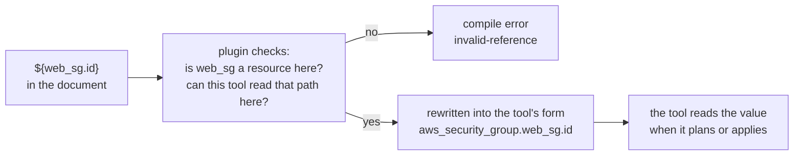
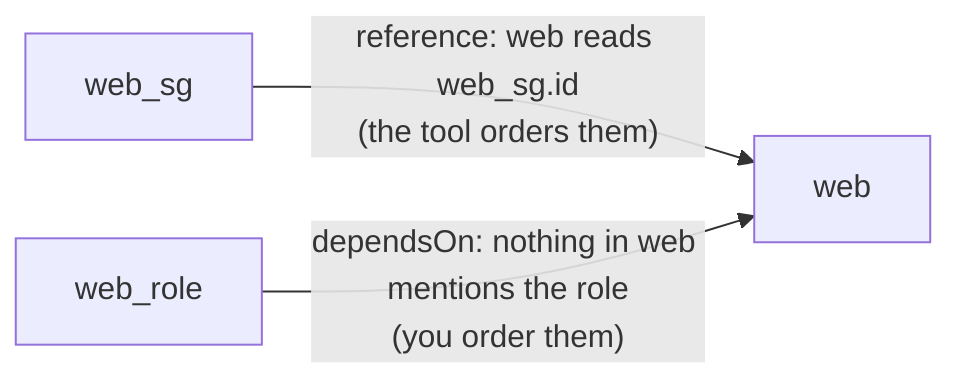

# References

A reference puts a value from one resource into another, or into an output.

```yaml
params:
  vpc_security_group_ids: ["${web_sg.id}"]
```

It is the third way resources are tied together. [`dependsOn`](dependson.md)
carries order, [`notifies`](notifies.md) carries a reaction, a reference carries
**data**.

## Where a reference can appear

| Place | Read |
|---|---|
| a text value anywhere inside `params`, however deeply nested | yes |
| an output's `value` | yes |
| `runtimeWhen` | no. It is the tool's own language, passed through untouched |
| `id`, `type`, `state`, `metadata`, a key of a mapping | no |

## Syntax

| You write | Meaning |
|---|---|
| `${id}` | the resource with that id, in the tool's own way of naming it |
| `${id.field}` | a value read from it |
| `${id.list[0].field}` | a path: any number of `.field` and `[index]` steps |
| `http://${web.ip}:8080` | a reference inside longer text; the value is placed in the text |
| `$${` | a literal `${`. Use it for text the tool should see as written, such as a shell variable in a script |
| `${upper(x.name)}`, `${a ? b : c}` | not a path: the tool's own expression language, on the targets that have one |

Details that matter:

- Spaces just inside the braces are ignored: `${ web.ip }` is `${web.ip}`.
- Braces inside an expression balance, so `${merge({a = 1}, x)}` is one
  expression.
- A `${` that is never closed is an error. No tool would read it the way you
  meant.
- The first name of a path is always the `id` of a resource in the **same
  document**. A reference never crosses documents; to carry a value to another
  document, declare an [output](outputs-and-hand-offs.md).
- A value that is only a reference keeps the type of what it reads, where the
  tool has types. Inside longer text it becomes text.

## How a reference is resolved

Meridian's core only *finds* references. The plugin *rewrites* each one into its
tool's own form, and the tool produces the value when it runs.



So two things are checked when the document is compiled, before anything runs:

1. **The resource exists.**

   ```
   ref.yaml:7:7: terraform: resource "a" [invalid-reference]: param "ami": ${img.id} refers to "img", which is not a resource in this document
   ```

2. **The tool can know that value at that point.** A param is fixed when the
   tool's file is written; an output is read after the apply. Some tools can
   therefore read less in a param than in an output:

   ```
   kubernetes: resource "a" [invalid-reference]: param "data": ${nosuch.x} refers to "nosuch", which is not an object in this document
   ```

What comes after the first name, the attribute or path, is the tool's to
judge. Meridian does not know every attribute of every Terraform type; if the
attribute does not exist, the tool says so when it plans.

## What a reference becomes, by target

| Target | `${id}` | `${id.path}` | Inside longer text | Not a path |
|---|---|---|---|---|
| `terraform` | the resource's address | an attribute: `aws_instance.web.public_ip`, or `data.aws_ami.ubuntu.id` for a data source | Terraform interpolation | Terraform's expression language |
| `cloudformation` | `Ref` | `Fn::GetAtt` | `Fn::Sub` | pseudo parameters: `${AWS::Region}` |
| `bicep` | the symbolic name | a property read | Bicep interpolation | Bicep's expression language: `${resourceGroup().location}` |
| `docker` | the element's name | in an output only: a published port, or a path into the container's inspection | the name placed in the text | refused |
| `kubernetes` | the object's name | in a param, only `metadata.name` and `metadata.namespace`; in an output, any path into the live object | the value placed in the text | refused |
| `dsc` | | `${id.Property}`: a property the other resource reported | | |
| `podman` | the unit's name | in an output: a path into `podman inspect` | the name placed in the text | |
| `ansible`, `puppet`, `chef`, `cloud-init` | not read: see [below](#configuration-management-the-shared-types) | | | |

Each target's page has its own table under "References".

## References and order

A reference usually implies an order: `web` cannot be created before the
security group whose id it reads.

- On tools that derive order from data (Terraform, CloudFormation, Bicep), the
  tool sees the reference and orders the two itself. The plugin does not also
  write a dependency.
- On DSC, the resource that reads is ordered after the one it reads.
- A reference does **not** add an edge to Meridian's own sort. If you need an
  order the tool cannot see from the data, write [`dependsOn`](dependson.md).



## Configuration management: the shared types

`ansible`, `puppet`, `chef` and `cloud-init` have nothing to read at apply time:
a package or a file is only what the document says about it. Today these targets do
not read references at all. `${...}` in a param is ordinary text, written to the
tool's file exactly as it stands, and `$${` is not unescaped either.

So on these targets, do not rely on `${id.param}` to copy a value from one
resource to another: repeat the value. A change that settles such references
from the document at compile time, and refuses the ones it cannot settle, is in
review; this section changes with it.

## A worked example

Three resources on Terraform, two references and one output:

```yaml
resources:
  - id: ubuntu
    type: data.aws_ami
    params:
      most_recent: true
      owners: ["099720109477"]

  - id: web_sg
    type: aws_security_group
    params:
      name: web

  - id: web
    type: aws_instance
    params:
      ami: ${ubuntu.id}
      instance_type: t3.small
      vpc_security_group_ids: ["${web_sg.id}"]

outputs:
  - name: url
    value: http://${web.public_ip}:8080
```

What the plugin writes:

| In the document | In `main.tf.json` |
|---|---|
| `${ubuntu.id}` | `${data.aws_ami.ubuntu.id}` |
| `${web_sg.id}` | `${aws_security_group.web_sg.id}` |
| `http://${web.public_ip}:8080` | `http://${aws_instance.web.public_ip}:8080` |

Terraform then orders `ubuntu` and `web_sg` before `web` by itself, and reports
`url` after the apply.

The full document is
[`examples/terraform/web-vm.yaml`](../../../examples/terraform/web-vm.yaml).
