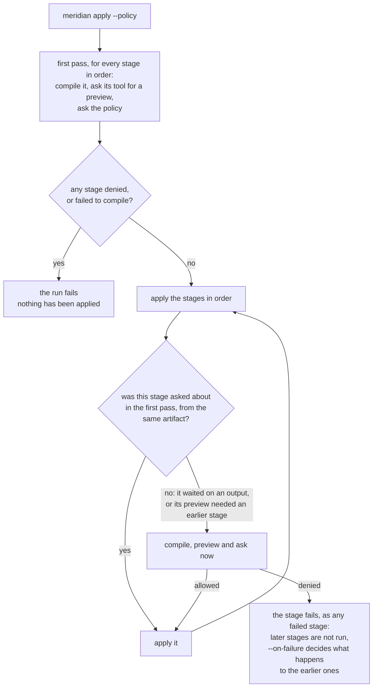
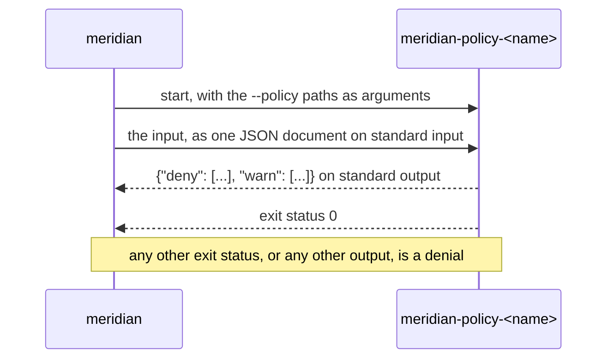

# Policy checks

A policy answers one question before a change is made: may it be? `meridian
plan` and `meridian apply` can ask a policy about every stage, and an apply
asks before it applies the first one.

```sh
meridian plan  site.yaml --policy policies/
meridian apply site.yaml --policy policies/
```

The policies shipped with Meridian are written in
[Rego](https://www.openpolicyagent.org/docs/latest/policy-language/) and read
by Open Policy Agent. Another policy language needs only
[an engine program](#writing-an-engine). The idea is explained in
[running safely](../concepts/run-safety.md#asking-a-policy-first); this page
is the reference.

## Options

| Option | Environment | Default | Meaning |
|---|---|---|---|
| `--policy PATH` | | no policy | `plan` and `apply`: a policy file or directory. May be repeated; every one is handed to the engine |
| `--policy-engine NAME` | `MERIDIAN_POLICY_ENGINE` | `opa` | the engine: the program `meridian-policy-<NAME>` in a [plugin directory](cli.md#options) |

With no `--policy`, no policy is asked and nothing here applies. `--policy`
on `compile`, `drift` or `rollback` is an error, so that a command that asks
no policy cannot be mistaken for one that did. A rollback is deliberately not
asked: it puts back what was applied before, and a policy written since must
not be able to hold a failed change in place.

A policy path that does not exist, or an engine that is not installed, is
refused before the run starts.

## When a policy is asked



- **`apply`** makes a first pass over every stage before it applies any of
  them. Each stage that can be compiled is compiled, previewed by its tool
  when the tool can preview, and put to the policy. If any stage is denied,
  the run fails with nothing applied, and the stages that were not denied are
  reported as not run.
- A stage **cannot be asked about in the first pass** when it waits on an
  output of a stage that has not been applied yet (a ResourceSet whose host
  is the address of a machine this run creates), or when its tool cannot
  preview it yet. It is asked about at its turn, just before its own apply.
  If it is denied then, the stages before it have been applied: the run stops
  as it does for any failed stage, and `--on-failure rollback` puts them
  back.
- A stage a [resumed run](../concepts/run-safety.md#picking-up-where-a-run-stopped)
  leaves alone is not asked about: nothing is done to it.
- **`plan`** asks about every stage and shows every denial. A denied stage
  is reported as failed and the command exits `1`, so a pipeline can refuse a
  merge on it. Unlike a tool's failure, a denial does not stop the plan: the
  stages after it are still planned and asked about.

Each stage is asked about once, and separately. An engine never sees two
stages at a time.

## What a policy says

An answer is two lists of messages.

| | Effect |
|---|---|
| `deny` | each message is a reason the change may not be made. Any message fails the stage |
| `warn` | each message is shown beside the stage, and stops nothing |

```
network (Infrastructure, target terraform)
  policy warning: network has no env label, so no environment's rules apply to it
  policy: allowed
  + create aws_vpc.main
```

```
network (Infrastructure, target terraform)
  FAILED: the policy does not allow this change:
      - network: aws_db_instance.main would be a replace in prod
web (ResourceSet, target ansible)
  not run, because Infrastructure "network" failed
run 2026-11-17T09-14-03Z-0cc7 was stopped by its policy before anything was applied
```

### Failing closed

A policy that could not be asked has not said yes. Each of these is a denial,
and says what went wrong:

- the engine cannot be started, or exits with anything but `0`;
- the engine's answer is not the JSON object described
  [below](#the-engine-protocol);
- with the OPA engine: `opa` is not installed, a policy does not parse, or
  the policies define nothing in the package `meridian`. That last one is
  far more often a misnamed package than a wish to allow everything.

## The input

For each stage the policy is given one JSON document. In Rego it is `input`.

```json
{
  "run":   {"id": "2026-11-17T09-14-03Z-0cc7", "mode": "apply"},
  "stage": {
    "name": "web",
    "kind": "ResourceSet",
    "target": "ansible",
    "category": "configuration-management",
    "host": "203.0.113.10",
    "labels": {"env": "prod", "tier": "web"}
  },
  "resources": [
    {"id": "nginx_conf", "type": "file", "state": "present",
     "params": {"path": "/etc/nginx/nginx.conf", "mode": "0644"}}
  ],
  "artifact": {"files": {"site.yml": "- hosts: all\n  tasks: ..."}},
  "plan": {
    "changes": [
      {"resource": "nginx_conf", "action": "update", "summary": "content differs"}
    ],
    "unknown": false
  }
}
```

| Field | Holds |
|---|---|
| `run.id` | the run's id |
| `run.mode` | `plan` or `apply` |
| `stage.name` | the document's `metadata.name` |
| `stage.kind` | `Infrastructure` or `ResourceSet` |
| `stage.target` | the document's `spec.target` |
| `stage.category` | what the target's plugin says it is: `infrastructure-as-code`, `configuration-management`, `containerization`, `container-orchestration` or `unspecified` |
| `stage.host` | the machine a ResourceSet configures; empty for an Infrastructure document |
| `stage.labels` | the document's `metadata.labels`; an empty object when it has none |
| `resources` | the resources as they were handed to the target, in order, after every [`when`](dsl/conditions.md) was decided: a resource a condition left out is not here |
| `resources[].id`, `.type`, `.state`, `.params` | as the document wrote them |
| `artifact.files` | what the document compiled to: each file's path and its whole text |
| `plan` | what the tool says an apply would change, or `null` when the target cannot preview |
| `plan.changes[].resource` | the id the tool reports, which is the document's resource id wherever the tool allows it |
| `plan.changes[].action` | `create`, `update`, `delete` or `replace`. A replace destroys and creates again |
| `plan.changes[].summary` | the tool's own one-line description; may be empty |
| `plan.unknown` | `true` when the tool could not say everything it would change |

The shape is part of Meridian's interface. Fields are added; none is renamed
or removed.

Two things to keep in mind when writing a rule:

- `plan` is `null` for a target that only compiles or cannot preview. A rule
  over `input.plan.changes` then simply does not fire. To refuse changes that
  could not be previewed, say so: `input.plan == null` or `input.plan.unknown`.
- The plan is the tool's preview at the time of asking. In an apply's first
  pass that is before any stage of this run has been applied.

## Secrets

The input holds what the document holds, so it can hold a secret: a param, a
line of a compiled file.

- It is handed to the engine on its standard input and nowhere else.
  Meridian never writes it to disk, and the OPA engine passes it to `opa` on
  standard input too.
- It is not recorded. Neither are the engine's messages, because a message
  can quote the input. The [run's record](state.md#events) keeps that a
  policy was asked, whether it allowed the stage, and how many denials and
  warnings there were.
- Messages are shown on the terminal, with every value a tool marked
  sensitive replaced by `(sensitive)`. A value Meridian does not know to be
  sensitive is shown as the policy wrote it, so prefer naming a resource to
  quoting its params.

## Events

| Type | When | `detail` |
|---|---|---|
| `policy.passed` | the policy allowed the stage | `kind`, `denials` (0), `warnings`, `asked` (`true`) |
| `policy.denied` | the policy denied the stage, or could not be asked | `kind`, `denials`, `warnings`, `asked`: `false` when the engine could not be asked |

A denied stage then has a `step.failed` event with the reason
`policy-denied`, and `meridian status` shows it as `failed (policy-denied)`.

```sh
meridian events --type 'policy.*'
```

## The OPA engine

`meridian-policy-opa` ships with Meridian. It needs
[Open Policy Agent](https://www.openpolicyagent.org/docs/latest/#running-opa)
1.0 or later as `opa` on the `PATH`, or the program named in `MERIDIAN_OPA`.

It reads `deny` and `warn` from the package `meridian`, the convention
[Conftest](https://www.conftest.dev/) uses. Each is a set of messages; a
message may be a string, or an object with the string under `msg`. Anything
else the package defines is ignored, so helper rules are free.

```rego
package meridian

import rego.v1

# Nothing in production is deleted, or destroyed and created again, by a run.
deny contains msg if {
	input.stage.labels.env == "prod"
	some change in input.plan.changes
	change.action in {"delete", "replace"}
	msg := sprintf("%s: %s would be a %s in prod", [input.stage.name, change.resource, change.action])
}

# Every stage says which environment it belongs to.
warn contains msg if {
	not input.stage.labels.env
	msg := sprintf("%s has no env label, so no environment's rules apply to it", [input.stage.name])
}
```

The whole example, with two more rules, is in
[`examples/policy`](https://github.com/ZanattaMichael/meridian-core/tree/main/examples/policy).

Every `--policy` path is given to `opa eval` as `--data`, so a directory is
loaded whole, and JSON or YAML files in it are available to the rules as
`data`. What the engine runs is:

```sh
opa eval --format json --stdin-input --data <path>... data.meridian
```

To try a policy without Meridian, save an input like the one above and run
that command with `--input input.json` in place of `--stdin-input`.

## The engine protocol

An engine is a program named `meridian-policy-<name>`, found where plugins
are found. For each stage Meridian starts it once.



| | |
|---|---|
| Arguments | the `--policy` paths, in the order given, exactly as typed |
| Standard input | [the input](#the-input), as one JSON document, then end of file |
| Standard output | one JSON object with `deny` and `warn`, each a list of strings, or of objects with a string under `msg`. Either may be left out. No other key is allowed |
| Standard error | on failure, why. Meridian shows the last line |
| Exit status | `0` when the engine answered, whether or not it denied anything. Anything else means it could not answer, which Meridian reads as a denial |
| Environment | Meridian's own; an engine reads its settings from there, as the OPA engine reads `MERIDIAN_OPA` |

### Writing an engine

An engine needs no library. This one, a shell script, denies every stage on a
Friday:

```sh
#!/bin/sh
# meridian-policy-friday
cat > /dev/null                      # the input; this policy does not need it
if [ "$(date +%u)" = 5 ]; then
  echo '{"deny": ["no changes on a Friday"]}'
else
  echo '{}'
fi
```

```sh
meridian apply site.yaml --policy . --policy-engine friday
```

An engine must not write the input anywhere, and should fail (exit non-zero)
on anything it does not understand.

## What this does not do yet

- A policy is asked about one stage at a time, so it cannot compare two
  stages of a run.
- There is no way to mark a denial as overridden for one run. Change the
  policy, or run without it.
- The engine is started once per stage. For a workflow with very many
  stages and a large policy set, that is `opa` started once per stage.
