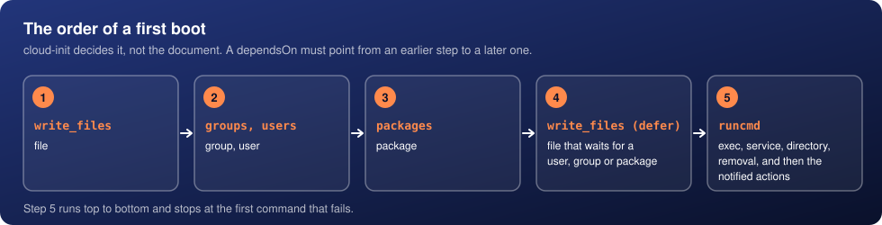

# cloud-init


The `cloud-init` target compiles a ResourceSet into **user-data**: the `#cloud-config`
document a cloud machine reads the first time it boots. Use it for what has to be true
before anything can reach the machine, such as the account a later stage logs in with,
its SSH key, and the packages a configuration tool needs to find there.

| | |
|---|---|
| Target name | `cloud-init` |
| Category | configuration management |
| Can | compile, plan, apply, outputs |
| Resource types | `exec`, `file`, `group`, `package`, `service`, `user` |
| Notify | emulated ([how](#notify)) |
| `runtimeWhen` | not supported |
| Plugin binary | `meridian-target-cloud-init` |

## How cloud-init differs from the other targets

Ansible, Puppet and Chef are pointed at a machine that exists and can be run against it
again and again. cloud-init is not. A machine is created *with* user-data and applies it
by itself, once, on its first boot. Three things follow, and the rest of this page is
those three things in detail:

1. **The order is cloud-init's.** Files, users, packages and commands are each handled
   at a fixed point of the boot, whatever order the document lists them in. See
   [the order of a first boot](#the-order-of-a-first-boot).
2. **Nothing can be undone or changed later.** A first boot can add a user or a package
   and cannot remove one. What cloud-init has no module for becomes a command, and what
   cannot be a command is refused. See [what is refused](#what-is-refused).
3. **Meridian does not apply it, the machine does.** `meridian apply` checks the
   user-data, keeps it where whatever creates the machine can read it, and can wait for
   the machine's first boot to finish. See [plan and apply](#plan-and-apply).

## A first example

[`plugins/cloud-init/examples/bootstrap.yaml`](../../plugins/cloud-init/examples/bootstrap.yaml)
gives a new machine an account to log in with, the packages a later stage needs, a
hardened SSH daemon and a Python environment:

```yaml
apiVersion: meridian/v1
kind: ResourceSet
metadata:
  name: bootstrap
spec:
  target: cloud-init
  targetHost:
    from: inline
    host: app01.example.com
  resources:
    - id: ops_group
      type: group
      params:
        name: ops

    - id: deploy_user
      type: user
      params:
        name: deploy
        gecos: Deployment account
        shell: /bin/bash
        groups: [ops]
        sudo: "ALL=(ALL) NOPASSWD:ALL"
        ssh_authorized_keys:
          - ssh-ed25519 AAAAC3NzaC1lZDI1NTE5AAAAIExampleKeyOnlyReplaceWithYourOwnPublicKey00 deploy@example.com
      dependsOn:
        - resource: ops_group

    - id: python
      type: package
      params:
        name: python3

    - id: python_venv
      type: package
      params:
        name: python3-venv

    # Owned by a user this document creates, so it is written after the user
    # exists. Nothing here has to say so.
    - id: app_env
      type: file
      params:
        path: /etc/app/env
        content: |
          APP_ENV=production
          APP_PORT=8080
        owner: deploy
        group: ops
        mode: "0640"

    - id: sshd_hardening
      type: file
      params:
        path: /etc/ssh/sshd_config.d/10-meridian.conf
        content: |
          PasswordAuthentication no
          PermitRootLogin no
        mode: "0600"
      notifies:
        - resource: sshd
          action: reload

    - id: sshd
      type: service
      params:
        name: ssh
        enabled: true

    - id: app_dir
      type: file
      state: directory
      params:
        path: /srv/app
        owner: deploy
        group: ops
        mode: "0750"
      dependsOn:
        - resource: deploy_user

    - id: app_venv
      type: exec
      params:
        command: python3 -m venv venv
        chdir: /srv/app
        creates: /srv/app/venv
      dependsOn:
        - resource: app_dir
        - resource: python_venv
```

Compile it:

```console
$ meridian compile plugins/cloud-init/examples/bootstrap.yaml --out build
bootstrap (ResourceSet, target cloud-init on app01.example.com)
  warning: cloud-init: cloud-init has no module for services, so resource "sshd" compiled to systemctl commands that run at the end of the first boot; the image must use systemd
  warning: cloud-init: cloud-init applies user-data once and never sees a later change, so notify is emulated: every notified action runs once, after all other first-boot commands, whether or not the notifying resource changed anything
  compiled 2 files into build/bootstrap
```

`build/bootstrap/user-data` is what the machine will read:

```yaml
#cloud-config
# Compiled by Meridian from the document "bootstrap". Change the document, not this file.
write_files:
  - path: /etc/ssh/sshd_config.d/10-meridian.conf
    content: |
      PasswordAuthentication no
      PermitRootLogin no
    permissions: "0600"
  - path: /etc/app/env
    content: |
      APP_ENV=production
      APP_PORT=8080
    owner: deploy:ops
    permissions: "0640"
    defer: true
groups:
  - ops
users:
  - default
  - name: deploy
    gecos: Deployment account
    groups:
      - ops
    shell: /bin/bash
    ssh_authorized_keys:
      - ssh-ed25519 AAAAC3NzaC1lZDI1NTE5AAAAIExampleKeyOnlyReplaceWithYourOwnPublicKey00 deploy@example.com
    sudo: ALL=(ALL) NOPASSWD:ALL
packages:
  - python3
  - python3-venv
runcmd:
  - set -e
  - systemctl enable --now ssh
  - install -d -m 0750 -o deploy -g ops /srv/app
  - if [ ! -e /srv/app/venv ]; then ( cd /srv/app && python3 -m venv venv ); fi
  - systemctl reload ssh
```

Things to notice in it:

- The document listed `app_env` before `sshd_hardening`, and the output has them the
  other way round. `app_env` is owned by `deploy`, a user this document creates, so it
  carries `defer: true` and is written after the user exists.
- `users` starts with `default`. Listing any user replaces cloud-init's own list, which
  holds the image's login user (`ubuntu`, `ec2-user` and so on). Meridian keeps it,
  because a document that adds a user did not ask to lose the one a cloud's console and
  key injection rely on.
- The service, the directory and the virtual environment are all under `runcmd`,
  because cloud-init has a module for none of them.
- The reload that `sshd_hardening` notifies is the last line.

The second file, `build/bootstrap/meta-data`, makes the directory a complete seed for
cloud-init's NoCloud data source:

```yaml
instance-id: meridian-bootstrap
local-hostname: app01.example.com
```

`local-hostname` is the document's host. It is left out when the host is an IP address,
which reaches a machine but does not name it.

## The order of a first boot



cloud-init runs each of its modules at a fixed point. Meridian places every resource at
one of five steps and then checks each `dependsOn` against the result.

| Step | cloud-init key | Resources |
|---|---|---|
| 1 | `write_files` | a `file` with content |
| 2 | `groups`, then `users` | `group`, `user` |
| 3 | `packages` | `package` |
| 4 | `write_files` with `defer: true` | a `file` with content that has something to wait for |
| 5 | `runcmd`, top to bottom | `exec`, `service`, a `file` in state `directory` or `absent`, and last the notified actions |

**When a file is deferred.** Meridian writes a file at step 4 instead of step 1 when
either is true:

- it has a `dependsOn` on a `group`, a `user`, a `package` or another deferred file;
- its `owner` or `group` is one this document creates.

You never write `defer` yourself. A configuration file that depends on the package it
configures is the usual case: it is written after the package is installed, so the
package's own default does not replace it.

**When a dependency is refused.** A `dependsOn` has to point from an earlier step to a
later one, or stay within a step. One that points backwards cannot be honoured, and the
compile says which two steps are the wrong way round:

```text
site.yaml:18:11: cloud-init: resource "conf" [unsatisfiable-order]: depends on "setup", but cloud-init writes files before it runs commands: the order of a first boot is cloud-init's own and a document cannot change it
```

The usual fix is to make the later thing a command too. A file that must be written
after a command can be written by an `exec`.

Within step 5 the commands run in the order the dependencies give them, and the list
starts with `set -e`, so the first command that fails stops the rest. Without it
cloud-init would carry on, run resources whose dependency had failed, and report only
the last command's result.

## Resource reference

A param or state that is not listed here is refused at compile time. Nothing is dropped
silently.

### `package`

| Param | | |
|---|---|---|
| `name` | required | The package name. |
| `version` | optional | A version to pin, as a string. Compiles to a `[name, version]` pair. |

State: `present` (the default) only.

### `file`

| Param | | |
|---|---|---|
| `path` | required | An absolute path. |
| `content` | required unless the state is `directory` or `absent` | The whole content of the file. |
| `owner`, `group` | optional | Compile to cloud-init's single `owner: user:group`. Each defaults to `root`. |
| `mode` | optional | An octal mode as a string, such as `"0644"`. Compiles to `permissions`. |
| `encoding` | optional | How `content` is encoded: `b64`, `gzip`, `gz+b64` and the other forms cloud-init reads. |
| `append` | optional | `true` adds to the file instead of replacing it. Needed for a second resource with the same path. |

| State | Compiles to |
|---|---|
| `present` or `file` (the default) | an entry under `write_files` |
| `directory` | `install -d -m <mode> -o <owner> -g <group> <path>` under `runcmd` |
| `absent` | `rm -rf -- <path>` under `runcmd` |

A file with no content is refused, because cloud-init would write an empty file over
whatever is there.

### `user`

| Param | | cloud-init key |
|---|---|---|
| `name` | required | `name` |
| `uid` | optional, a whole number | `uid` |
| `home` | optional | `homedir` |
| `shell` | optional | `shell` |
| `groups` | optional, one name or a list | `groups` |
| `primary_group` | optional | `primary_group` |
| `gecos` | optional | `gecos` |
| `system` | optional, `true` or `false` | `system` |
| `lock_passwd` | optional, `true` or `false` | `lock_passwd` |
| `sudo` | optional, one rule or a list | `sudo` |
| `ssh_authorized_keys` | optional, one key or a list | `ssh_authorized_keys` |

State: `present` (the default) only. The last five params are cloud-init's own. They
are here because the account and key a first boot sets up are usually the reason for
using cloud-init at all.

### `group`

| Param | | |
|---|---|---|
| `name` | required | The group name. |
| `members` | optional, one name or a list | Users to add to it. |

State: `present` (the default) only. cloud-init cannot choose a group's id, so `gid` is
refused.

### `service`

cloud-init has no module for services. A service compiles to `systemctl` commands under
`runcmd`, and the compile warns that the image must use systemd.

| Param | | |
|---|---|---|
| `name` | required | The unit name. |
| `enabled` | optional, `true` or `false` | Whether it starts at boot. |

| State | `enabled` not given | `enabled: true` | `enabled: false` |
|---|---|---|---|
| `running` or `started` (the default) | `systemctl start` | `systemctl enable --now` | `systemctl disable`, then `start` |
| `stopped` | `systemctl stop` | `systemctl enable`, then `stop` | `systemctl disable --now` |
| `restarted` | `systemctl restart` | `systemctl enable`, then `restart` | `systemctl disable`, then `restart` |
| `reloaded` | `systemctl reload` | `systemctl enable`, then `reload` | `systemctl disable`, then `reload` |

### `exec`

| Param | | |
|---|---|---|
| `command` | required | The command line. |
| `shell` | optional | `true` runs the command as a line of shell: pipes, variables and redirection work. |
| `chdir` | optional | A directory to run it in. |
| `creates` | optional | A path. The command is skipped if it exists. |
| `removes` | optional | A path. The command is skipped if it does not exist. |

`exec` takes no state.

Without `shell: true` the command is split into words and each word is quoted, so
nothing in it is expanded:

```yaml
- id: warm
  type: exec
  params:
    command: /usr/local/bin/warm-cache --tag "nightly build" $HOME
```

```yaml
runcmd:
  - set -e
  - /usr/local/bin/warm-cache --tag 'nightly build' '$HOME'
```

`chdir`, `creates` and `removes` are compiled around the command. The directory change
is kept in a subshell, so it does not carry over to the next command:

```yaml
runcmd:
  - set -e
  - if [ ! -e /srv/app/venv ]; then ( cd /srv/app && python3 -m venv venv ); fi
```

## Notify

cloud-init applies user-data once and never sees a later change, so it has nothing like
a handler. On that one run, though, every resource does change. Meridian therefore runs
each notified action once, after every other command, and warns that this is what
`notifies` means on this target.

| Notified type | Actions | Compiles to |
|---|---|---|
| `service` | `start`, `stop`, `restart`, `reload` | `systemctl <action> <name>` |
| `exec` | `run` | the resource's own command again |

Two resources that notify the same action on the same resource share one command.
Notifying any other type is refused.

## What is refused

Each of these stops the compile with the resource, the rule and the line.

| You wrote | Rule | Why |
|---|---|---|
| `state: absent` on a `user`, `group` or `package`; `state: latest` on a `package` | `unsupported-state` | A first boot adds things. Use an `exec` to remove what an image ships with. |
| `runtimeWhen` on any resource | `unsupported-runtime-condition` | cloud-init evaluates nothing per resource. Put the test inside an `exec` command. |
| a `dependsOn` that points backwards through the five steps | `unsatisfiable-order` | The order of a first boot cannot be changed. |
| a `file` with no `content` | `missing-param` | It would empty the file. |
| a relative `path` | `relative-path` | A first boot has no working directory. |
| removing `/` | `unsafe-path` | |
| `mode: 644` without quotes, or a mode that is not octal | `invalid-param`, `invalid-mode` | cloud-init takes the mode as a string of octal digits. |
| two files with one `path`, the second without `append: true` | `duplicate-file-path` | The second would silently replace the first. |
| two users, groups or packages with one name | `duplicate-user`, `duplicate-group`, `duplicate-package` | |
| a command with an unclosed quote and no `shell: true` | `invalid-command` | It cannot be split into words. |
| a param the type does not take here, such as `gid` on a `group` | `unsupported-param` | The message lists the ones accepted. |

One thing is a warning and not a refusal: user-data larger than 16 KB, which is what
Amazon EC2 accepts. Other clouds allow more.

## Plan and apply

cloud-init cannot be pointed at a machine, so `plan` and `apply` are about the
user-data and where it is kept, and optionally about waiting for the machine.

**`meridian plan`** has `cloud-init schema` check the user-data on the machine running
Meridian, and reports whether the seed would change. It leaves the seed as it is and
contacts no machine.

```console
$ meridian plan bootstrap.yaml
bootstrap (ResourceSet, target cloud-init on app01.example.com)
  + create user-data: seed would be written to /work/.meridian/resourceset/bootstrap/cloud-init/seed; a machine applies it on its first boot
  1 change to make
```

**`meridian apply`** runs the same check and then writes the **seed**: a directory
holding `user-data` and `meta-data`. It reports where the seed is as two outputs.

```console
$ meridian apply bootstrap.yaml
bootstrap (ResourceSet, target cloud-init on app01.example.com)
  + create user-data: seed written to /work/.meridian/resourceset/bootstrap/cloud-init/seed; a machine applies it on its first boot
  applied 1 change
  output seed_dir = "/work/.meridian/resourceset/bootstrap/cloud-init/seed"
  output user_data_file = "/work/.meridian/resourceset/bootstrap/cloud-init/seed/user-data"
```

Applying a document whose seed is already current changes nothing. User-data that
cloud-init rejects never becomes the seed, so the seed always holds the last version
that passed.

### Using the seed

Hand `user_data_file` to whatever creates the machine. For example:

```console
$ aws ec2 run-instances --user-data file://.meridian/resourceset/bootstrap/cloud-init/seed/user-data ...
$ az vm create --custom-data .meridian/resourceset/bootstrap/cloud-init/seed/user-data ...
$ multipass launch --cloud-init .meridian/resourceset/bootstrap/cloud-init/seed/user-data
```

For a machine with no metadata service, such as a local virtual machine, turn the seed
directory into a NoCloud disk and attach it:

```console
$ cloud-localds seed.iso .meridian/resourceset/bootstrap/cloud-init/seed/user-data \
    .meridian/resourceset/bootstrap/cloud-init/seed/meta-data
```

### Waiting for the first boot

Set `MERIDIAN_CLOUD_INIT_WAIT=ssh` and `apply` also runs
`cloud-init status --wait --long` on the document's host over SSH. It returns when the
first boot is over, relays what cloud-init reports, and fails the stage if cloud-init
says the boot failed. A later stage, such as an Ansible document for the same host,
then starts only on a machine that is ready.

This is the piece that fits cloud-init into a workflow. The Infrastructure document
creates the machine with the seed's user-data and reports its address. The cloud-init
document takes that address as its host and waits there:

```yaml
apiVersion: meridian/v1
kind: ResourceSet
metadata:
  name: bootstrap
spec:
  target: cloud-init
  targetHost:
    from: infrastructure
    ref: network
    output: address
  resources:
    - id: python
      type: package
      params:
        name: python3
```

Because the machine has to be created with user-data that already exists, the first
run goes in two steps: compile or apply the cloud-init document on its own with an
inline host to produce the seed, then run the whole workflow. Passing the user-data
from one stage straight into the stage that creates the machine is not something
Meridian's orchestrator does yet.

### Settings

The plugin reads its settings from the environment of the `meridian` command.

| Variable | Default | Meaning |
|---|---|---|
| `MERIDIAN_CLOUD_INIT` | `cloud-init` | The cloud-init program used for the check. |
| `MERIDIAN_CLOUD_INIT_VALIDATE` | `on` | `off` skips the check, for a machine with no cloud-init, such as a Mac. |
| `MERIDIAN_CLOUD_INIT_WAIT` | `off` | `ssh` makes `apply` wait for the first boot. |
| `MERIDIAN_CLOUD_INIT_SSH` | `ssh` | The SSH program used to wait. |
| `MERIDIAN_CLOUD_INIT_SSH_ARGS` | none | Extra SSH arguments, split on spaces, such as `-l ubuntu -i ~/.ssh/deploy`. |

SSH is always run with `-o BatchMode=yes`, so a wait fails instead of stopping to ask
for a password.

If cloud-init is not installed and the check is on, `plan` and `apply` fail and say so.
They do not skip the check on their own.

## Troubleshooting

**`could not run cloud-init: it is not installed`.** Install cloud-init on the machine
that runs Meridian, name its path with `MERIDIAN_CLOUD_INIT`, or set
`MERIDIAN_CLOUD_INIT_VALIDATE=off`. cloud-init runs only on Linux.

**`cloud-init rejected the user-data`.** The lines above the error are cloud-init's own
report. Meridian's compile should never produce user-data that fails this check, so
please report it with the document.

**`cloud-init on <host> reports that the first boot failed`.** A command under `runcmd`
failed, or a module did. On the machine, `cloud-init status --long` names the module
and `/var/log/cloud-init-output.log` has the command's output.

**`could not reach <host> over ssh`.** The wait could not log in. Check the user and key
in `MERIDIAN_CLOUD_INIT_SSH_ARGS`, and that the account in the user-data is the one
being used.

**A file came out with `defer: true` and you did not expect it.** It depends on, or is
owned by, something created at a later step. See
[the order of a first boot](#the-order-of-a-first-boot).

## How this plugin is tested

- Golden files in `plugins/cloud-init/testdata` record the exact bytes compiled from
  the example above, from a document that uses every key the target can write, and
  from the shared fixtures in `fixtures/`.
- The compiled commands are run by a real shell in a scratch directory, to prove the
  guards, the quoting and the stop on first failure behave as this page says.
- The runner is tested against stand-ins for `cloud-init` and `ssh`, and the plugin
  binary is driven through the host and the orchestrator as it would be in a workflow.
- The `cloud-init` workflow installs the real cloud-init and has `cloud-init schema`
  check every recorded user-data file.
- A test compares the example and its output on this page with the files, so the page
  cannot drift from what the plugin does.
